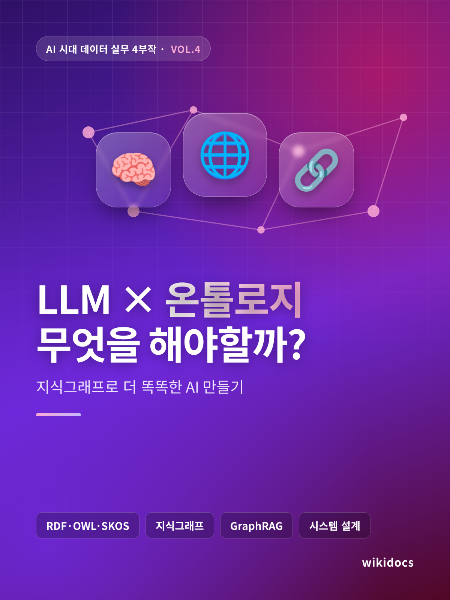

# LLM × 온톨로지 무엇을 해야할까?

**지식그래프로 더 똑똑한 AI 만들기**

온톨로지와 지식그래프의 기초부터, LLM으로 온톨로지를 구축하고 온톨로지로 LLM의 정확도를 높이는 방법(GraphRAG 등)까지 실습 중심으로 정리합니다.

## 이런 분께 추천합니다

- AI 개발자
- 데이터 설계자
- 지식관리 실무자

## 이 책의 구성

| 장 | 내용 |
|---|---|
| 01. 온톨로지 기초 | 온톨로지가 무엇이고 왜 LLM 시대에 다시 주목받는지, 기본 구성 요소를 알아봅니다. |
| 02. 표준과 언어 | RDF·RDFS·OWL·SKOS·SHACL 등 온톨로지를 표현하는 표준을 실습합니다. |
| 03. 지식그래프와 질의 | 지식그래프를 저장하고 SPARQL·Cypher로 질의하는 방법을 다룹니다. |
| 04. LLM으로 온톨로지 만들기 | LLM으로 문서에서 개념과 관계를 추출해 온톨로지를 만드는 과정입니다. |
| 05. 온톨로지로 LLM 강화 | 온톨로지와 지식그래프로 LLM의 정확도를 높이는 GraphRAG 등을 다룹니다. |
| 06. RAG와 LLM 시스템 설계 | RAG의 종류와 온톨로지의 관계, 앞으로의 LLM 활용 방향, 그리고 원하는 지식 시스템을 설계하고 LLM을 역할별로 배치하는 방법을 다룹니다. |
| 07. 평가와 품질 | 온톨로지와 GraphRAG의 품질을 측정하고 점검하는 방법입니다. |
| 08. 실전 프로젝트 | 금융·개인정보·사내 지식 온톨로지를 직접 만들어 봅니다. |
| 09. 최신 동향 | 빠르게 변하는 기법과 도구의 변화를 기록합니다. |
| 90. 부록 | 도구 비교와 용어집을 모았습니다. |

## 「AI 시대 데이터 실무 4부작」 시리즈

시리즈 전체 소개: [AI 시대 데이터 실무 4부작](https://wikidocs.net/wiki/9013/)

- [AI 300% 활용법](https://wikidocs.net/book/22293)
- [가명정보 A to Z](https://wikidocs.net/book/22299)
- [파이썬으로 시작하는 실전 퀀트 투자](https://wikidocs.net/book/22336)

## 저자

저자명
