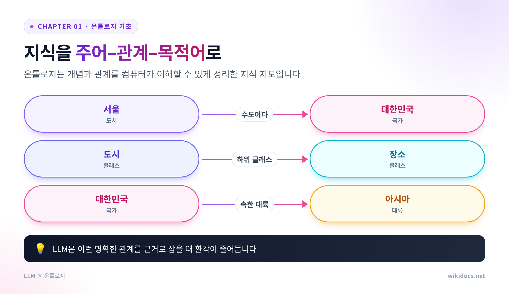

<!--
**상태**: 🔵 검토 중
**분류**: 01. 온톨로지 기초
**태그**: #기초
**작성일**: 2026-11-22
-->
> 📅 **최종 확인**: 2026-11-22

온톨로지(Ontology)는 어떤 분야의 **개념과 그 개념들 사이의 관계를 명확하게 정의한 지식 지도**입니다. 사람은 "서울은 대한민국의 수도"라는 문장을 쉽게 이해하지만, 컴퓨터가 이 지식을 정확히 다루려면 개념과 관계를 정해진 형식으로 적어 주어야 합니다.

## 요약

- 온톨로지는 **개념(클래스), 개체(인스턴스), 관계(속성)**를 정해진 형식으로 정의한 것입니다.
- 지식은 **주어–관계–목적어**(트리플) 형태로 표현합니다.
- 온톨로지에 실제 데이터를 채운 것을 **지식그래프**라고 부릅니다.

## 지식을 트리플로 표현하기



온톨로지에서는 모든 지식을 세 부분으로 나눠 적습니다.

| 주어 | 관계 | 목적어 |
|---|---|---|
| 서울 | 수도이다 | 대한민국 |
| 도시 | 하위 클래스이다 | 장소 |
| 대한민국 | 속한 대륙 | 아시아 |

이렇게 적어 두면 컴퓨터가 **추론**할 수 있습니다. 예를 들어 "서울은 도시다"와 "도시는 장소의 하위 클래스다"라는 두 사실에서 "서울은 장소다"라는 새로운 사실을 이끌어 낼 수 있습니다.

## 온톨로지와 지식그래프

| 구분 | 무엇을 정의하나 | 비유 |
|---|---|---|
| 온톨로지 | 어떤 종류의 개념과 관계가 있는지 (설계도) | 데이터베이스의 스키마 |
| 지식그래프 | 온톨로지에 따라 실제 개체와 사실을 채운 것 | 스키마에 채운 실제 데이터 |

```text
[온톨로지]   국가 ─수도→ 도시
[지식그래프] 대한민국 ─수도→ 서울
             일본 ─수도→ 도쿄
```

[[TIP("알아두기")]]

온톨로지라는 말은 원래 철학에서 "존재하는 것이 무엇인가"를 다루는 분야의 이름입니다. 컴퓨터 과학에서는 "어떤 분야에 존재하는 개념과 관계를 명시적으로 정의한 것"이라는 뜻으로 씁니다.

[[/TIP]]

## 어디에 쓰나

| 분야 | 활용 예 |
|---|---|
| 검색 | "서울에 있는 박물관"처럼 관계를 따라가는 검색 |
| 의료 | 질병·증상·약물의 관계를 표준 용어로 정리 |
| 금융 | 기업·산업·공급망 관계 분석 (『파이썬으로 시작하는 실전 퀀트 투자』 09장) |
| 데이터 통합 | 부서마다 다른 이름으로 부르는 같은 개념 연결 |
| AI | LLM이 정확한 사실을 근거로 답하게 하기 (05장 GraphRAG) |

## 실무 체크포인트

- [ ] 다루려는 분야의 핵심 개념을 10개 이내로 적어 봤는가
- [ ] 개념 사이의 관계를 "주어–관계–목적어"로 적어 볼 수 있는가
- [ ] 설계도(온톨로지)와 실제 데이터(지식그래프)를 구분했는가

## 관련 페이지

- 01-2. 개념·클래스·속성·관계
- 01-3. 택소노미·시소러스와의 차이
- 📚 02-1. RDF와 트리플
