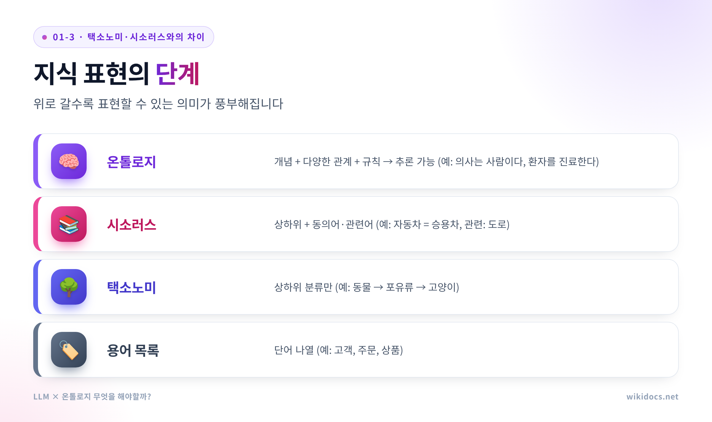

<!--
**상태**: 🔵 검토 중
**분류**: 01. 온톨로지 기초
**태그**: #기초
**작성일**: 2026-11-22
-->
> 📅 **최종 확인**: 2026-11-22

"분류 체계 만들어 두었는데, 이것도 온톨로지인가요?" 자주 받는 질문입니다. 지식을 정리하는 방법은 단순한 용어 목록부터 온톨로지까지 여러 단계가 있습니다. 단계별 차이를 알면 **우리 업무에 어느 수준이 필요한지** 판단할 수 있습니다.

## 요약

- **용어 목록 → 택소노미 → 시소러스 → 온톨로지** 순서로 표현력이 풍부해집니다.
- 택소노미는 **상하위 분류**, 시소러스는 여기에 **동의어·관련어**를 더합니다.
- 온톨로지는 **다양한 관계와 규칙**까지 정의해 컴퓨터가 추론할 수 있게 합니다.

## 지식 표현의 단계



| 단계 | 표현하는 것 | 예시 | 쓰임 |
|---|---|---|---|
| 용어 목록 | 단어 나열 | 고객, 주문, 상품 | 용어 통일 |
| 택소노미 | 상하위 분류 | 동물 → 포유류 → 고양이 | 쇼핑몰 카테고리, 문서 분류 |
| 시소러스 | 상하위 + 동의어·관련어 | 자동차 = 승용차, 관련어: 도로 | 검색어 확장 |
| 온톨로지 | 개념 + 다양한 관계 + 규칙 | 의사는 사람이다, 의사는 환자를 진료한다 | 추론, 데이터 통합, AI |

## 같은 지식을 단계별로 표현하면

```text
[택소노미]
의료인
 ├─ 의사
 └─ 간호사

[시소러스] 택소노미 +
의사 = 의료진(동의어), 관련어: 병원

[온톨로지] 시소러스 +
의사 ─하위 클래스→ 사람
의사 ─진료한다→ 환자
진료한다의 주어는 의료인, 목적어는 환자
```

택소노미만으로는 "의사가 환자를 진료한다"는 사실을 표현할 수 없습니다. 이런 **분류가 아닌 관계**를 다뤄야 할 때 온톨로지가 필요합니다.

[[TIP("요령: 작게 시작하기")]]

처음부터 완전한 온톨로지를 만들 필요는 없습니다. 이미 있는 **분류 체계(택소노미)에서 시작**해, 필요한 관계를 하나씩 추가하는 방식이 현실적입니다. SKOS 표준(02-3)은 택소노미·시소러스를 표현하기에 알맞고, 나중에 온톨로지로 확장하기도 쉽습니다.

[[/TIP]]

## 우리에게 필요한 단계 고르기

| 이런 요구가 있다면 | 추천 단계 |
|---|---|
| 부서마다 다른 용어를 통일하고 싶다 | 용어 목록 |
| 문서·상품을 카테고리로 나누고 싶다 | 택소노미 |
| 검색할 때 동의어도 찾아 주고 싶다 | 시소러스 |
| 여러 데이터를 연결하고, 관계를 따라 질문하고 싶다 | 온톨로지 |
| LLM이 정확한 사실을 근거로 답하게 하고 싶다 | 온톨로지 + 지식그래프 |

## 실무 체크포인트

- [ ] 이미 있는 분류 체계나 용어집이 있는지 확인했는가
- [ ] 분류(상하위)만 필요한지, 다양한 관계가 필요한지 판단했는가
- [ ] 필요한 단계보다 지나치게 복잡하게 설계하지 않았는가

## 관련 페이지

- 01-2. 개념·클래스·속성·관계
- 01-4. 왜 LLM 시대에 온톨로지인가
- 📚 02-3. SKOS로 용어 체계 만들기
