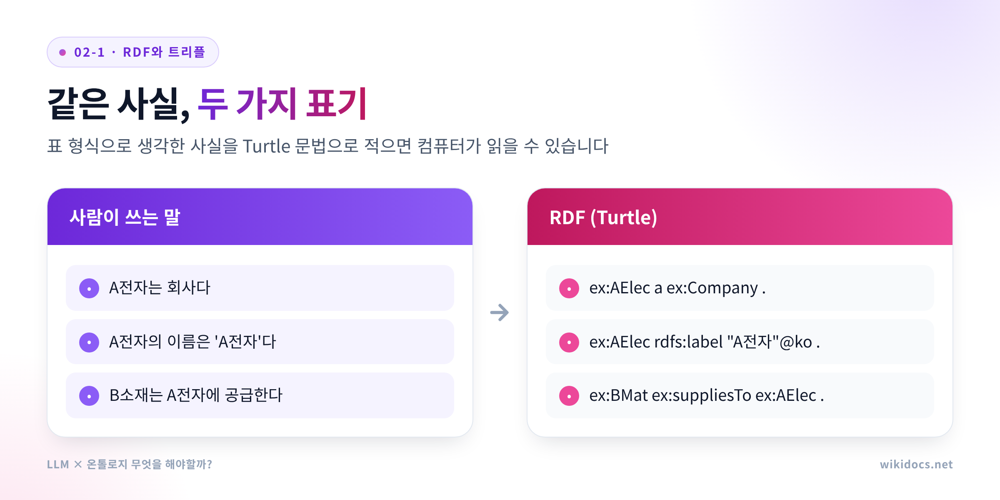

<!--
**상태**: 🔵 검토 중
**분류**: 02. 표준과 언어
**태그**: #표준 #RDF
**작성일**: 2026-11-22
-->
> 📅 **최종 확인**: 2026-11-22

RDF(Resource Description Framework)는 W3C가 정한 **지식 표현의 기본 문법**입니다. 01장에서 본 "주어–관계–목적어" 트리플을 컴퓨터가 읽고 교환할 수 있는 형식으로 적는 방법입니다. 이 책의 모든 예제는 RDF로 작성합니다.

## 요약

- RDF는 모든 지식을 **트리플(주어, 관계, 목적어)** 로 표현합니다.
- 주어·관계는 **IRI**(웹 주소 형태의 고유 이름)로, 목적어는 IRI 또는 **리터럴**(문자·숫자 값)로 씁니다.
- 사람이 읽기 쉬운 표기법인 **Turtle**을 주로 사용합니다.

## 같은 사실, 두 가지 표기



## RDF의 세 가지 재료

| 재료 | 설명 | 예시 |
|---|---|---|
| IRI | 전 세계에서 하나뿐인 이름. 보통 웹 주소 형태 | `http://example.org/onto#AElec` |
| 리터럴 | 문자열·숫자·날짜 같은 값. 언어 태그나 자료형을 붙일 수 있음 | `"A전자"@ko`, `1990` |
| 빈 노드 | 이름 없이 다른 노드를 묶을 때 쓰는 임시 노드 | 주소(도시+도로명)를 묶을 때 |

[[TIP("알아두기: 접두어(prefix)")]]

IRI는 길기 때문에 `@prefix ex: <http://example.org/onto#> .`처럼 접두어를 정해 `ex:AElec`로 줄여 씁니다. `rdf:`, `rdfs:`, `owl:`, `xsd:`는 표준에서 쓰는 접두어입니다. `a`는 `rdf:type`(유형)의 줄임말입니다.

[[/TIP]]

## 예시 데이터: 이 책의 가상 회사들

이 책은 처음부터 끝까지 **하나의 예제 데이터**를 사용합니다. 저장소의 `code/data/company.ttl`에 있으며, 모든 회사·사람·제품은 가상입니다.

```text
D화학 ──공급한다──▶ B소재 ──공급한다──▶ A전자 ◀──경쟁한다──▶ C전자
  └────────────────공급한다──────────────────────────────▶ C전자
김민준 ──근무한다──▶ A전자      이서연 ──근무한다──▶ B소재
```

Turtle로는 다음처럼 적습니다.

```turtle
@prefix ex:   <http://example.org/onto#> .
@prefix rdfs: <http://www.w3.org/2000/01/rdf-schema#> .

ex:AElec a ex:Company ;
    rdfs:label "A전자"@ko ;
    ex:inIndustry ex:Electronics ;
    ex:foundedYear 1990 ;
    ex:competesWith ex:CElec .

ex:BMat a ex:Company ;
    rdfs:label "B소재"@ko ;
    ex:suppliesTo ex:AElec .
```

`;`는 "같은 주어로 계속", `.`은 "이 주어에 대한 설명 끝"이라는 뜻입니다.

## 코드: 파이썬으로 트리플 만들기

`rdflib` 라이브러리로 트리플을 만들고 Turtle로 저장합니다. 전체 코드는 `code/01_rdf_basics.py`입니다.

```python
from rdflib import Graph, Literal, Namespace, RDF, RDFS

EX = Namespace("http://example.org/onto#")
g = Graph()
g.bind("ex", EX)

g.add((EX.AElec, RDF.type, EX.Company))
g.add((EX.AElec, RDFS.label, Literal("A전자", lang="ko")))
g.add((EX.BMat, EX.suppliesTo, EX.AElec))

print(f"트리플 수: {len(g)}")
print(g.serialize(format="turtle"))

# 무엇이 A전자에 공급하는가?
for s, p, o in g.triples((None, EX.suppliesTo, EX.AElec)):
    print("공급사:", s.split("#")[-1])
```

**실행 결과**

```text
트리플 수: 3

@prefix ex: <http://example.org/onto#> .
@prefix rdfs: <http://www.w3.org/2000/01/rdf-schema#> .

ex:BMat ex:suppliesTo ex:AElec .

ex:AElec a ex:Company ;
    rdfs:label "A전자"@ko .

공급사: BMat
```

## 여러 가지 표기법

| 표기법 | 특징 | 쓰임 |
|---|---|---|
| Turtle (.ttl) | 사람이 읽기 쉬움 | 직접 작성, 이 책의 기본 |
| N-Triples (.nt) | 한 줄에 트리플 하나 | 대용량 처리, 줄 단위 비교 |
| JSON-LD (.jsonld) | JSON 형식 | 웹 개발, API, 웹페이지 구조화 데이터 |
| RDF/XML (.rdf) | XML 형식 | 오래된 시스템과 교환 |

어떤 표기법이든 **담긴 트리플은 같습니다.** rdflib에서는 `g.serialize(format="json-ld")`처럼 형식만 바꿔 저장할 수 있습니다.

## 실무 체크포인트

- [ ] 우리 조직의 IRI 규칙(기본 주소, 이름 짓는 법)을 정했는가
- [ ] 이름(label)에 언어 태그(`@ko`, `@en`)를 붙였는가
- [ ] 숫자·날짜 값에 알맞은 자료형을 썼는가

## 근거·출처

| 구분 | 출처 | 비고 |
|---|---|---|
| 표준 | [RDF 1.1 Concepts and Abstract Syntax (W3C)](https://www.w3.org/TR/rdf11-concepts/) | IRI·리터럴·빈 노드 |
| 표준 | [RDF 1.1 Turtle (W3C)](https://www.w3.org/TR/turtle/) | Turtle 문법 |
| 도구 | [rdflib 문서](https://rdflib.readthedocs.io/) | 파이썬 라이브러리 |

## 관련 페이지

- 02-2. RDFS와 OWL
- 📚 01-1. 온톨로지란 무엇인가
- 📚 03-2. SPARQL 기초
