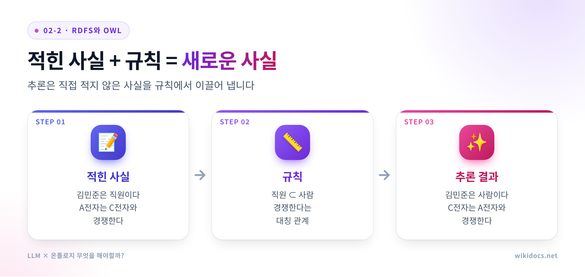

<!--
**상태**: 🔵 검토 중
**분류**: 02. 표준과 언어
**태그**: #표준 #RDFS #OWL
**작성일**: 2026-11-22
-->
> 📅 **최종 확인**: 2026-11-22

RDF만으로는 "직원은 사람의 한 종류다" 같은 **개념 사이의 규칙**을 표현하기 어렵습니다. RDFS와 OWL은 RDF 위에 이런 규칙을 적는 어휘를 더합니다. 규칙이 있으면 컴퓨터가 직접 적지 않은 사실까지 **추론**할 수 있습니다.

## 요약

- **RDFS**: 클래스·속성의 계층(subClassOf)과 범위(domain·range)를 정의합니다.
- **OWL**: 대칭·역관계·동치·개수 제한 등 더 풍부한 규칙을 정의합니다.
- 추론 덕분에 데이터를 일일이 적지 않아도 **숨은 사실**을 찾을 수 있습니다.

## 적힌 사실 + 규칙 = 새로운 사실



## RDFS 핵심 어휘

| 어휘 | 뜻 | 예시 |
|---|---|---|
| `rdfs:subClassOf` | 하위 클래스 | 직원 ⊂ 사람, 회사 ⊂ 조직 |
| `rdfs:subPropertyOf` | 하위 속성 | 대표이사이다 ⊂ 근무한다 |
| `rdfs:domain` | 속성의 주어 유형 | 근무한다의 주어는 사람 |
| `rdfs:range` | 속성의 목적어 유형 | 근무한다의 목적어는 회사 |
| `rdfs:label` | 사람이 읽는 이름 | "A전자"@ko |

## OWL 자주 쓰는 어휘

| 어휘 | 뜻 | 예시 |
|---|---|---|
| `owl:SymmetricProperty` | 대칭 관계 (A→B이면 B→A) | 경쟁한다 |
| `owl:inverseOf` | 역관계 | 공급한다 ↔ 공급받는다 |
| `owl:TransitiveProperty` | 이행 관계 (A→B, B→C이면 A→C) | 하위 부서이다 |
| `owl:equivalentClass` | 같은 개념 | 회사 ≡ 기업 |
| `owl:sameAs` | 같은 개체 | 우리 데이터의 A전자 = 외부 데이터의 A전자 |
| `owl:disjointWith` | 겹칠 수 없음 | 사람과 회사는 동시에 될 수 없음 |
| 개수 제한(cardinality) | 값의 개수 제한 | 회사의 설립연도는 하나 |

## 예시: 이 책 데이터의 스키마

```turtle
ex:Company  a owl:Class ; rdfs:subClassOf ex:Organization .
ex:Employee a owl:Class ; rdfs:subClassOf ex:Person .

ex:worksFor a owl:ObjectProperty ;
    rdfs:domain ex:Person ; rdfs:range ex:Company .

ex:competesWith a owl:ObjectProperty , owl:SymmetricProperty ;
    rdfs:domain ex:Company ; rdfs:range ex:Company .
```

## 코드: 추론 결과 확인하기

추론 엔진(리즈너)을 따로 쓰지 않고도, SPARQL의 **속성 경로** `rdfs:subClassOf*`로 클래스 계층을 따라가 같은 효과를 낼 수 있습니다. 전체 코드는 `code/02_rdfs_inference.py`입니다.

```python
from common import load, label

g = load()   # code/data/company.ttl

q_direct = "SELECT ?type WHERE { ex:Minjun a ?type }"
q_infer  = "SELECT DISTINCT ?type WHERE { ex:Minjun a/rdfs:subClassOf* ?type }"
q_sym = """SELECT ?x ?y WHERE {
  { ?x ex:competesWith ?y } UNION { ?y ex:competesWith ?x } }"""

print("직접 적힌 유형:", [label(g, r.type) for r in g.query(q_direct)])
print("추론 포함 유형:", sorted(label(g, r.type) for r in g.query(q_infer)))
print("경쟁 관계(대칭 반영):", sorted((label(g, r.x), label(g, r.y)) for r in g.query(q_sym)))
```

**실행 결과**

```text
직접 적힌 유형: ['직원']
추론 포함 유형: ['사람', '직원']
경쟁 관계(대칭 반영): [('A전자', 'C전자'), ('C전자', 'A전자')]
```

데이터에는 "김민준은 직원"과 "A전자는 C전자와 경쟁한다"만 적혀 있지만, 규칙 덕분에 "김민준은 사람", "C전자도 A전자와 경쟁한다"를 알 수 있습니다.

[[TIP("알아두기: 추론 엔진")]]

실무에서는 HermiT, Pellet 같은 OWL 추론기나 트리플스토어의 내장 추론 기능을 씁니다. 파이썬에서는 `owlrl` 라이브러리로 RDFS·OWL RL 수준의 추론 결과를 그래프에 추가할 수 있습니다. 규칙이 많아질수록 추론에 시간이 오래 걸리므로, **필요한 규칙만** 쓰는 것이 좋습니다.

[[/TIP]]

## 주의: domain·range는 "검사"가 아니라 "추론"

RDFS의 domain·range는 잘못된 데이터를 막아 주지 않습니다. 예를 들어 "김민준 —근무한다→ 서울"이라고 적으면, 추론기는 오류를 내는 대신 **"서울은 회사다"라고 추론**해 버립니다. 데이터가 규칙을 지키는지 **검사**하려면 02-4의 SHACL을 씁니다.

## 실무 체크포인트

- [ ] 클래스 계층이 실제로 필요한 단계만 있는가
- [ ] 대칭·역관계처럼 자주 쓰는 규칙을 OWL로 표현했는가
- [ ] 데이터 검사가 목적이라면 domain·range 대신 SHACL을 쓰고 있는가

## 근거·출처

| 구분 | 출처 | 비고 |
|---|---|---|
| 표준 | [RDF Schema 1.1 (W3C)](https://www.w3.org/TR/rdf-schema/) | RDFS 어휘 |
| 표준 | [OWL 2 Web Ontology Language Primer (W3C)](https://www.w3.org/TR/owl2-primer/) | OWL 입문 |
| 도구 | [OWL-RL (파이썬)](https://github.com/RDFLib/OWL-RL) | RDFS·OWL RL 추론 |

## 관련 페이지

- 02-1. RDF와 트리플
- 02-4. SHACL로 데이터 검증하기
- 📚 01-2. 개념·클래스·속성·관계
