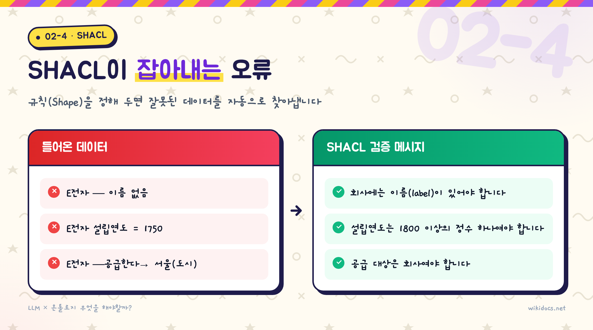

<!--
**상태**: 🔵 검토 중
**분류**: 02. 표준과 언어
**태그**: #표준 #검증 #SHACL
**작성일**: 2026-11-22
-->
> 📅 **최종 확인**: 2026-11-22

지식그래프에 잘못된 데이터가 들어가면, 그 데이터를 근거로 한 LLM의 답도 틀립니다. SHACL(Shapes Constraint Language)은 **데이터가 지켜야 할 모양(Shape)을 정의하고 자동으로 검사**하는 W3C 표준입니다. 특히 LLM이 추출한 데이터를 받아들이기 전 **관문**으로 쓰기 좋습니다.

## 요약

- SHACL은 "회사에는 이름이 꼭 있어야 한다" 같은 **검사 규칙**을 정의합니다.
- 검사 결과는 어떤 데이터가 어떤 규칙을 어겼는지 **메시지로** 알려 줍니다.
- 02-2의 domain·range(추론)와 달리, SHACL은 **잘못된 데이터를 막는** 데 씁니다.

## SHACL이 잡아내는 오류



## 자주 쓰는 제약

| 제약 | 뜻 | 예시 |
|---|---|---|
| `sh:minCount` / `sh:maxCount` | 값 개수 | 이름 최소 1개, 설립연도 최대 1개 |
| `sh:datatype` | 값의 자료형 | 설립연도는 정수 |
| `sh:class` | 연결 대상의 클래스 | 공급 대상은 회사 |
| `sh:minInclusive` / `sh:maxInclusive` | 값의 범위 | 설립연도 1800 이상 |
| `sh:pattern` | 문자열 형식 | 사업자번호 형식 |
| `sh:in` | 허용 값 목록 | 상태는 "운영", "폐업" 중 하나 |

## 예시: 회사 데이터 규칙

```turtle
ex:CompanyShape a sh:NodeShape ;
    sh:targetClass ex:Company ;
    sh:property [ sh:path rdfs:label ; sh:minCount 1 ;
                  sh:message "회사에는 이름(label)이 있어야 합니다" ] ;
    sh:property [ sh:path ex:foundedYear ; sh:maxCount 1 ; sh:datatype xsd:integer ;
                  sh:minInclusive 1800 ;
                  sh:message "설립연도는 1800 이상의 정수 하나여야 합니다" ] ;
    sh:property [ sh:path ex:suppliesTo ; sh:class ex:Company ;
                  sh:message "공급 대상은 회사여야 합니다" ] .
```

## 코드: 오류 데이터 검사하기

`pyshacl` 라이브러리로 검사합니다. 전체 코드는 `code/04_shacl.py`입니다.

```python
from pyshacl import validate
from rdflib import Graph

BAD_DATA = """
ex:EElec a ex:Company ;          # 이름 없음
    ex:foundedYear 1750 ;        # 범위 위반
    ex:suppliesTo ex:Seoul .     # 회사가 아닌 대상 (서울은 도시)
"""

conforms, _, text = validate(Graph().parse(data=BAD_DATA, format="turtle"),
                             shacl_graph=Graph().parse(data=SHAPES, format="turtle"))
print("규칙 준수:", conforms)
```

**실행 결과**

```text
[오류가 있는 데이터] 규칙 준수: False
  - 공급 대상은 회사여야 합니다
  - 설립연도는 1800 이상의 정수 하나여야 합니다
  - 회사에는 이름(label)이 있어야 합니다

[책 예제 데이터 company.ttl] 규칙 준수: True
```

세 가지 오류를 모두 찾아냈고, 이 책의 예제 데이터는 규칙을 모두 지킵니다.

[[TIP("요령: LLM 추출 결과의 관문으로")]]

LLM이 문서에서 뽑은 트리플을 바로 지식그래프에 넣지 말고, **임시 그래프에 넣고 SHACL 검사를 통과한 것만** 반영하세요. 통과하지 못한 데이터는 오류 메시지와 함께 사람 검토 목록으로 보냅니다. (04-4 참고)

[[/TIP]]

## 실무 체크포인트

- [ ] 핵심 클래스마다 필수 속성과 값 형식을 SHACL로 정의했는가
- [ ] 오류 메시지를 사람이 이해할 수 있는 한국어로 적었는가
- [ ] 새 데이터를 넣기 전에 SHACL 검사를 자동으로 실행하는가

## 근거·출처

| 구분 | 출처 | 비고 |
|---|---|---|
| 표준 | [Shapes Constraint Language (SHACL) (W3C)](https://www.w3.org/TR/shacl/) | 제약 정의 |
| 도구 | [pySHACL](https://github.com/RDFLib/pySHACL) | 파이썬 검사기 |

## 관련 페이지

- 02-2. RDFS와 OWL
- 📚 04-4. 사람의 검토 절차 설계
- 📚 07-2. 논리적 일관성 검사
