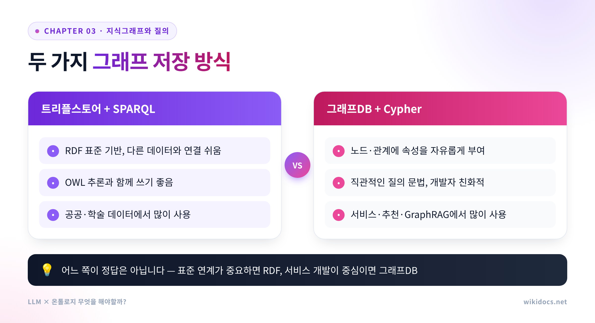

<!--
**상태**: 🔵 검토 중
**분류**: 03. 지식그래프와 질의
**태그**: #지식그래프
**작성일**: 2026-11-22
-->
> 📅 **최종 확인**: 2026-11-22

지식그래프를 저장하는 방식은 크게 **트리플스토어**와 **그래프 데이터베이스(속성 그래프)** 두 가지입니다. 둘 다 "노드와 관계"로 데이터를 다루지만, 데이터 모델과 질의 언어가 다릅니다. 프로젝트 목적에 맞는 쪽을 고르는 기준을 정리합니다.

## 요약

- **트리플스토어**: RDF 표준을 그대로 저장하고 SPARQL로 질의합니다. 표준 연계와 추론에 강합니다.
- **그래프DB(속성 그래프)**: 노드와 관계에 속성을 자유롭게 붙이고 Cypher 등으로 질의합니다. 개발 편의성이 좋습니다.
- 어느 한쪽이 정답은 아닙니다. **무엇과 연결하고, 누가 쓰는지**로 고릅니다.

## 두 가지 저장 방식



## 데이터 모델 비교

같은 사실 "B소재는 2023년부터 A전자에 공급한다"를 두 방식으로 표현해 봅니다.

**트리플스토어 (RDF)** — 관계 자체에 속성(2023년)을 붙이려면 별도 노드를 만들어야 합니다.

```turtle
ex:BMat ex:suppliesTo ex:AElec .

ex:Supply001 a ex:SupplyContract ;
    ex:supplier ex:BMat ;
    ex:buyer    ex:AElec ;
    ex:since    2023 .
```

**그래프DB (Cypher)** — 관계에 바로 속성을 붙일 수 있습니다.

```cypher
CREATE (b:Company {name: "B소재"})-[:SUPPLIES_TO {since: 2023}]->(a:Company {name: "A전자"})
```

[[TIP("알아두기")]]

최신 RDF 1.2 작업에서는 트리플 자체에 정보를 붙이는 방법(트리플에 대한 트리플)이 논의되고 있고, 여러 트리플스토어가 이미 비슷한 기능을 제공합니다. 도입 전에 사용할 제품의 지원 여부를 확인하세요.

[[/TIP]]

## 비교표

| 기준 | 트리플스토어 | 그래프DB |
|---|---|---|
| 데이터 모델 | RDF 트리플 | 속성 그래프 (노드·관계·속성) |
| 질의 언어 | SPARQL (W3C 표준) | Cypher, GQL 등 |
| 표준 연계 | 공공데이터·위키데이터 등 RDF 데이터와 바로 연결 | 변환 필요 |
| 추론 | RDFS·OWL 추론 지원 제품 많음 | 보통 직접 구현 |
| 개발 편의 | 학습 곡선이 있음 | 직관적, 개발자 친숙 |
| 대표 제품 예 | Apache Jena Fuseki, GraphDB, Virtuoso | Neo4j, Memgraph |

> 제품 기능과 라이선스는 자주 바뀝니다. 부록 90-1 도구 비교에서 확인 날짜와 함께 관리합니다.

## 무엇을 고를까

| 우리 상황 | 추천 |
|---|---|
| 공공데이터·표준 용어(예: 의료 표준 용어)와 연결해야 함 | 트리플스토어 |
| OWL 추론이 중요함 | 트리플스토어 |
| 서비스 개발팀이 빠르게 만들어야 함, 추천·탐색 기능 중심 | 그래프DB |
| 관계에 날짜·가중치 같은 속성을 많이 붙임 | 그래프DB |
| 아직 모르겠음, 작게 시작 | 파이썬 rdflib(메모리)로 시작해 규모가 커지면 결정 |

## 실무 체크포인트

- [ ] 연결해야 할 외부 데이터가 RDF 형식인지 확인했는가
- [ ] 관계에 속성을 얼마나 붙여야 하는지 예시로 적어 봤는가
- [ ] 운영할 팀이 익숙한 질의 언어를 고려했는가

## 근거·출처

| 구분 | 출처 | 비고 |
|---|---|---|
| 표준 | [SPARQL 1.1 Query Language (W3C)](https://www.w3.org/TR/sparql11-query/) | 트리플스토어 질의 |
| 표준 | [RDF 1.2 Concepts (W3C 작업 문서)](https://www.w3.org/TR/rdf12-concepts/) | 트리플에 대한 트리플 |
| 표준 | [openCypher](https://opencypher.org/) | Cypher 언어 |

## 관련 페이지

- 03-2. SPARQL 기초
- 03-3. Cypher 기초
- 📚 90-1. 도구 비교
