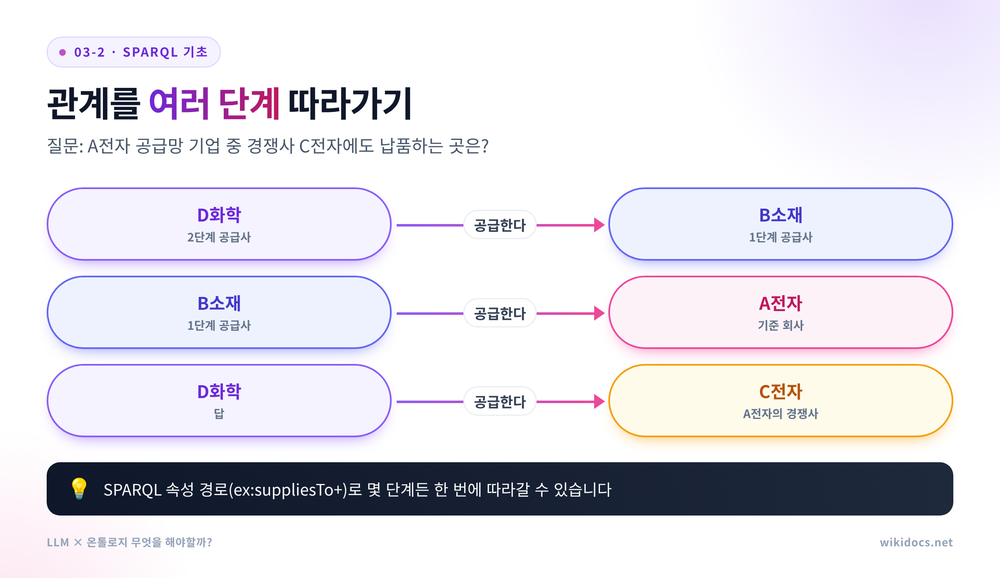

<!--
**상태**: 🔵 검토 중
**분류**: 03. 지식그래프와 질의
**태그**: #지식그래프 #질의 #SPARQL
**작성일**: 2026-11-22
-->
> 📅 **최종 확인**: 2026-11-22

SPARQL은 RDF 지식그래프에 질문하는 W3C 표준 질의 언어입니다. SQL과 비슷해 보이지만, 표를 조회하는 대신 **트리플 패턴을 그래프에 맞춰 보는** 방식으로 동작합니다. 이 페이지에서는 예제 데이터로 다섯 가지 질문에 답해 봅니다.

[TOC]

## 요약

- SPARQL은 `?변수`가 들어간 **트리플 패턴**을 그래프에서 찾습니다.
- `FILTER`(조건), `GROUP BY`(집계), `ORDER BY`(정렬)로 SQL처럼 다듬습니다.
- **속성 경로**(`/`, `+`, `*`)로 여러 단계의 관계를 한 줄로 따라갈 수 있습니다. 그래프 질의의 가장 큰 장점입니다.

## 기본 모양

```sparql
PREFIX ex:   <http://example.org/onto#>
PREFIX rdfs: <http://www.w3.org/2000/01/rdf-schema#>

SELECT ?name ?year           # 돌려받을 변수
WHERE {
  ?c a ex:Company ;          # ?c 는 회사이고
     rdfs:label ?name ;      # 이름이 ?name 이고
     ex:foundedYear ?year .  # 설립연도가 ?year 인 것
}
ORDER BY ?year
```

## 예제: 다섯 가지 질문

전체 코드는 `code/05_sparql.py`입니다. 모든 결과는 실제 실행 결과입니다.

### ① 모든 회사와 설립연도 (오래된 순)

위의 기본 모양 질의를 실행합니다.

```text
D화학 | 1975
A전자 | 1990
C전자 | 2001
B소재 | 2008
```

### ② 2000년 이후 설립된 회사 — `FILTER`

```sparql
SELECT ?name WHERE {
  ?c a ex:Company ; rdfs:label ?name ; ex:foundedYear ?y .
  FILTER(?y >= 2000)
}
```

```text
C전자
B소재
```

### ③ 산업별 회사 수 — `GROUP BY`

```sparql
SELECT ?industry (COUNT(?c) AS ?n) WHERE {
  ?c ex:inIndustry/rdfs:label ?industry .
} GROUP BY ?industry ORDER BY DESC(?n)
```

```text
전자 | 2
2차전지 소재 | 1
화학 | 1
```

`ex:inIndustry/rdfs:label`은 "산업으로 가서, 그 이름을 가져온다"는 두 단계를 한 번에 적은 **속성 경로**입니다.

### ④ A전자의 공급망 2단계까지

```sparql
SELECT ?supplier ?step WHERE {
  { ?s ex:suppliesTo ex:AElec . BIND(1 AS ?step) }
  UNION
  { ?s ex:suppliesTo/ex:suppliesTo ex:AElec . BIND(2 AS ?step) }
  ?s rdfs:label ?supplier .
} ORDER BY ?step
```

```text
B소재 | 1
D화학 | 2
```

### ⑤ A전자 공급망 기업 중 경쟁사에도 납품하는 곳



```sparql
SELECT DISTINCT ?name WHERE {
  ?s ex:suppliesTo+ ex:AElec .     # A전자 공급망 (몇 단계든)
  ex:AElec ex:competesWith ?rival . # A전자의 경쟁사
  ?s ex:suppliesTo ?rival .         # 그 경쟁사에도 공급
  ?s rdfs:label ?name .
}
```

```text
D화학
```

SQL로 같은 질문에 답하려면 공급 관계 테이블을 여러 번 조인하거나 재귀 쿼리를 써야 합니다. SPARQL에서는 `+` 하나로 **몇 단계든** 따라갑니다.

[[TIP("요령: LLM에게 SPARQL 작성 맡기기")]]

LLM에게 SPARQL을 맡길 때는 **사용할 수 있는 클래스·속성 목록(스키마)**을 함께 주세요. 스키마 없이 요청하면 존재하지 않는 속성 이름을 지어내는 경우가 많습니다. 05-1의 스키마 기반 프롬프트 방법을 그대로 응용할 수 있습니다.

[[/TIP]]

## 자주 쓰는 문법 요약

| 문법 | 쓰임 | 예 |
|---|---|---|
| `OPTIONAL { }` | 없어도 되는 정보 | 설립연도가 없는 회사도 포함 |
| `FILTER NOT EXISTS { }` | 특정 패턴이 없는 것 | 공급사가 없는 회사 |
| `p1/p2` | 연속 경로 | 산업의 이름 |
| `p+` / `p*` | 1번 이상 / 0번 이상 반복 | 공급망 전체 |
| `^p` | 역방향 | 공급받는 쪽에서 거꾸로 |
| `CONSTRUCT` | 결과를 새 그래프로 | 요약 그래프 만들기 |

## 실무 체크포인트

- [ ] 자주 묻는 질문을 SPARQL로 미리 만들어 두었는가
- [ ] 여러 단계 관계는 속성 경로로 간단히 적었는가
- [ ] LLM이 만든 SPARQL은 실행해서 결과를 확인했는가

## 근거·출처

| 구분 | 출처 | 비고 |
|---|---|---|
| 표준 | [SPARQL 1.1 Query Language (W3C)](https://www.w3.org/TR/sparql11-query/) | 문법·속성 경로 |
| 도구 | [rdflib 문서](https://rdflib.readthedocs.io/) | 파이썬에서 SPARQL 실행 |

## 관련 페이지

- 03-1. 트리플스토어 vs 그래프 데이터베이스
- 03-3. Cypher 기초
- 📚 05-2. GraphRAG 이해와 구현
