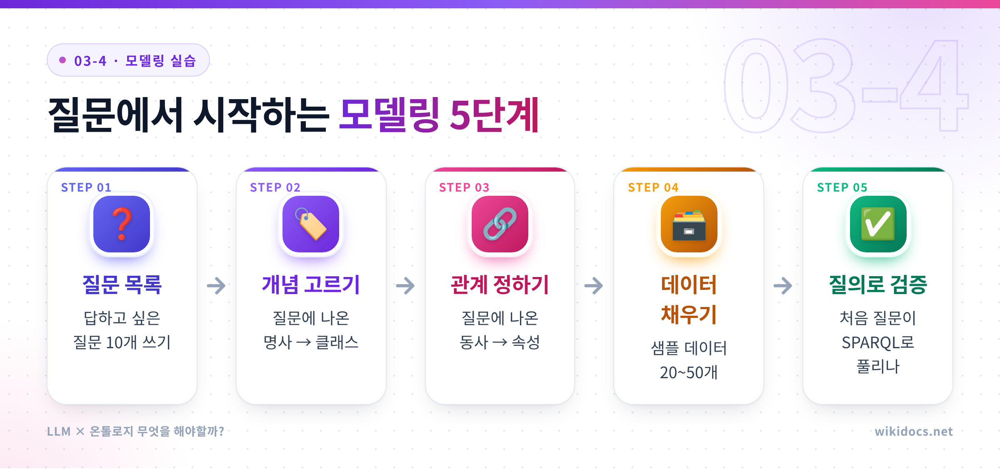

<!--
**상태**: 🔵 검토 중
**분류**: 03. 지식그래프와 질의
**태그**: #지식그래프 #모델링
**작성일**: 2026-11-22
-->
> 📅 **최종 확인**: 2026-11-22

지식그래프 모델링에서 가장 흔한 실패는 "일단 모든 개념을 다 넣자"로 시작하는 것입니다. 성공하는 방법은 반대입니다. **답하고 싶은 질문에서 시작해서**, 그 질문에 필요한 개념과 관계만 만듭니다. 이 방법을 "역량 질문(Competency Questions)" 방식이라고 부릅니다.

## 요약

- 먼저 지식그래프가 **답해야 할 질문** 목록을 적습니다.
- 질문 속 **명사는 클래스**, **동사는 관계** 후보가 됩니다.
- 샘플 데이터를 넣고 처음 질문이 **SPARQL로 풀리는지** 확인하면 모델링이 끝납니다.

## 모델링 5단계



## 실습: 공급망 리스크 지식그래프

### 1단계: 질문 목록 쓰기

```text
Q1. A전자에 직접 공급하는 회사는?
Q2. A전자의 공급망을 2단계까지 거슬러 올라가면?
Q3. 우리 공급사 중 경쟁사에도 납품하는 곳은?
Q4. 특정 산업에 속한 공급사가 몇 개인가?
Q5. 공급사 담당자는 누구인가?
```

### 2단계: 명사 → 클래스

| 질문 속 명사 | 클래스 |
|---|---|
| 회사, 공급사, 경쟁사 | 회사 (공급사·경쟁사는 클래스가 아니라 **관계로 정해지는 역할**) |
| 산업 | 산업 |
| 담당자 | 사람 (직원) |

[[TIP("핵심: 역할은 관계로")]]

"공급사"를 클래스로 만들면, 한 회사가 어떤 회사에는 공급사이고 다른 회사에는 고객인 상황을 표현하기 어렵습니다. **역할은 관계(공급한다)로 표현**하고, 클래스는 변하지 않는 본질(회사)로 정하는 것이 좋습니다.

[[/TIP]]

### 3단계: 동사 → 관계

| 질문 속 동사 | 관계 | 주어 → 목적어 |
|---|---|---|
| 공급하다 | 공급한다 | 회사 → 회사 |
| 경쟁하다 | 경쟁한다 (대칭) | 회사 → 회사 |
| 속하다 | 속한 산업 | 회사 → 산업 |
| 담당하다·근무하다 | 근무한다 | 사람 → 회사 |

### 4단계: 샘플 데이터 넣기

이 책의 `code/data/company.ttl`이 바로 이 과정으로 만든 데이터입니다. 회사 4곳, 산업 3개, 사람 2명, 제품 2개로 시작했습니다.

### 5단계: 질의로 검증

| 질문 | 검증 결과 |
|---|---|
| Q1~Q4 | 03-2의 SPARQL ①~⑤로 모두 답할 수 있음 ✅ |
| Q5 | "근무한다"만으로는 '담당'을 구분할 수 없음 ⚠️ → `담당한다` 관계 추가 필요 |

이처럼 검증 단계에서 빠진 관계가 드러나면 3단계로 돌아가 보완합니다.

## 실무 체크포인트

- [ ] 실제 사용자에게 받은 질문 10개 이상으로 시작했는가
- [ ] 역할(공급사·고객)을 클래스가 아닌 관계로 표현했는가
- [ ] 모든 질문을 SPARQL로 실행해 답이 나오는지 확인했는가

## 근거·출처

| 구분 | 출처 | 비고 |
|---|---|---|
| 방법론 | [Ontology Development 101 (Noy & McGuinness, Stanford)](https://protege.stanford.edu/publications/ontology_development/ontology101.pdf) | 온톨로지 개발 입문, 역량 질문 |

## 관련 페이지

- 03-2. SPARQL 기초
- 📚 01-2. 개념·클래스·속성·관계
- 📚 08-1. 금융 온톨로지 구축
