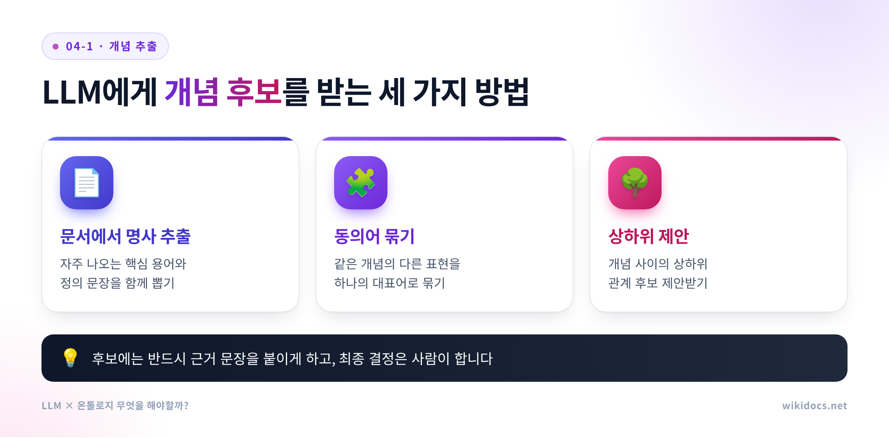

<!--
**상태**: 🔵 검토 중
**분류**: 04. LLM으로 온톨로지 만들기
**태그**: #LLM #추출
**작성일**: 2026-11-22
-->
> 📅 **최종 확인**: 2026-11-22

온톨로지를 만들 때 가장 시간이 많이 드는 일은 **도메인 문서를 읽고 핵심 개념을 골라내는 일**입니다. LLM은 이 일을 빠르게 도와줍니다. 이 페이지에서는 LLM에게 개념 후보를 받는 방법과 바로 쓸 수 있는 프롬프트를 정리합니다.

## 요약

- LLM에게 **개념 후보·정의·동의어·상하위 관계 후보**를 받습니다.
- 모든 후보에는 **근거 문장**을 함께 받아야 검토할 수 있습니다.
- LLM은 후보를 만드는 역할이고, **최종 결정은 사람**이 합니다.

## LLM에게 개념 후보를 받는 세 가지 방법



## 프롬프트 1: 핵심 개념 추출

```text
너는 온톨로지 설계를 돕는 분석가야.
아래 [문서]를 읽고 이 분야의 핵심 개념을 뽑아 줘.

[규칙]
1. 고유명사(특정 회사·사람 이름)는 개념이 아니라 "개체"로 따로 분류해.
2. 개념마다 문서에 나온 정의 문장이 있으면 그대로 인용해. 없으면 "정의 없음".
3. 문서에 없는 개념은 만들지 마.

[출력 형식] 표
| 개념 | 개념/개체 구분 | 정의 문장(인용) | 등장 횟수 |

[문서]
(배터리 산업 보고서 일부 붙여 넣기)
```

**결과 예시** (설명을 위한 가상 예시)

| 개념 | 구분 | 정의 문장(인용) | 등장 횟수 |
|---|---|---|---|
| 양극재 | 개념 | "양극재는 배터리의 용량과 출력을 결정하는 핵심 소재이다" | 12 |
| 음극재 | 개념 | 정의 없음 | 5 |
| B소재 | 개체 | — | 4 |

## 프롬프트 2: 동의어 묶기

```text
아래 용어 목록에서 같은 개념을 가리키는 것끼리 묶어 줘.
각 묶음마다 대표어 하나를 고르고, 대표어를 고른 이유를 한 줄로 적어 줘.
확신이 없는 묶음은 "확인 필요"로 표시해 줘.

[용어 목록]
배터리, 2차전지, 축전지, 이차 전지, 양극 소재, 양극재, 캐소드
```

이 결과는 그대로 02-3의 SKOS 용어 체계(prefLabel·altLabel)로 옮길 수 있습니다.

## 프롬프트 3: 상하위 관계 제안

```text
다음 개념들 사이의 상하위 관계(A는 B의 한 종류다)를 제안해 줘.
- "A는 B의 한 종류다"가 항상 참인 경우만 상하위 관계로 적어.
- "A는 B의 일부다"(부분 관계)는 상하위가 아니니 따로 적어.

[개념] 2차전지 소재, 양극재, 음극재, 전해질, 2차전지
```

[[TIP("주의: 종류와 부분을 구분하기")]]

LLM은 "양극재는 2차전지의 하위 개념"처럼 **부분 관계를 상하위 관계로 착각**하는 경우가 많습니다. 양극재는 2차전지의 *한 종류*가 아니라 *부품*입니다. 프롬프트에서 둘을 구분하라고 분명히 적고, 결과를 반드시 검토하세요.

[[/TIP]]

## 실무 체크포인트

- [ ] 개념과 개체(고유명사)를 구분해 받았는가
- [ ] 모든 후보에 근거 문장이 있는가
- [ ] 상하위 관계와 부분 관계를 구분했는가
- [ ] 동의어 묶음을 SKOS 용어집에 반영했는가

## 관련 페이지

- 04-2. 관계 추출과 트리플 생성
- 04-4. 사람의 검토 절차 설계
- 📚 02-3. SKOS로 용어 체계 만들기
- 📚 『AI 300% 활용법』 03-6. 구조화된 출력 받기
