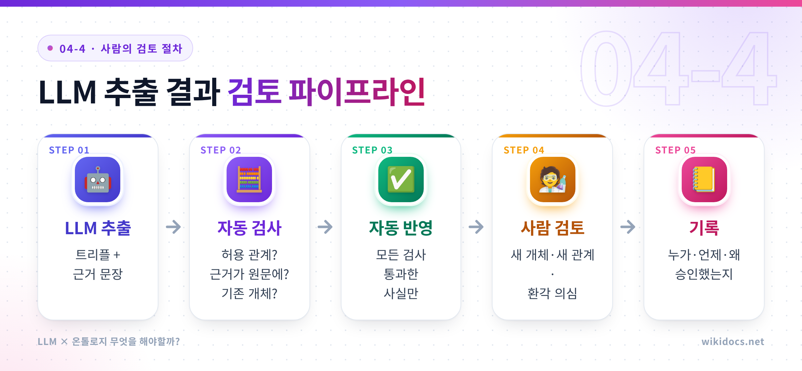

<!--
**상태**: 🔵 검토 중
**분류**: 04. LLM으로 온톨로지 만들기
**태그**: #LLM #검증
**작성일**: 2026-11-22
-->
> 📅 **최종 확인**: 2026-11-22

LLM으로 온톨로지를 만들 때 품질을 결정하는 것은 프롬프트보다 **검토 절차**입니다. 사람이 모든 결과를 다 볼 수는 없으므로, 자동 검사로 걸러 낸 뒤 **사람은 꼭 필요한 것만** 보게 설계합니다.

## 요약

- 검토 흐름: **LLM 추출 → 자동 검사 → 자동 반영 또는 사람 검토 → 기록**
- 사람은 **새 개체, 새 관계, 환각 의심, 낮은 확신** 네 가지만 검토합니다.
- 누가·언제·왜 승인했는지 **기록**을 남겨야 나중에 오류를 추적할 수 있습니다.

## 검토 파이프라인



## 자동 검사 항목

| 검사 | 방법 | 실패하면 |
|---|---|---|
| 허용된 관계인가 | 온톨로지의 관계 목록과 비교 | 사람 검토 (새 관계 후보) |
| 근거가 원문에 있는가 | 근거 문장 문자열 검색 | 사람 검토 (환각 의심) |
| 알려진 개체인가 | 이름·동의어로 기존 개체 검색 | 사람 검토 (새 개체 등록) |
| 데이터 규칙을 지키는가 | SHACL 검사 (02-4) | 반려 또는 수정 요청 |
| 기존 사실과 충돌하는가 | SPARQL로 모순 확인 (07-2) | 사람 검토 |

04-2의 예제 코드가 이 중 위의 세 가지를 실제로 수행합니다.

## 사람 검토 화면 예시

검토자가 빠르게 판단할 수 있도록 **원문, 추출 결과, 검사 결과**를 한 줄에 보여 줍니다.

| 추출 결과 | 근거 문장 | 자동 검사 | 판단 | 메모 |
|---|---|---|---|---|
| B소재 -공급한다→ E배터리 | "B소재는 E배터리와 양극재 공급 계약을 맺었다" | 새 개체 | ✅ 승인 (E배터리 회사로 등록) | 계약 기사 확인 |
| A전자 -본사 위치→ 서울 | "A전자는 서울에 본사를 두고 있다" | 없는 관계 | 🔁 보류 (관계 추가 검토) | 위치 정보 필요성 논의 |
| B소재 -공급한다→ F모터스 | "B소재는 F모터스에 공급한다" | 환각 의심 | ❌ 반려 | 원문에 없음 |

## 검토 기록 남기기

승인한 사실에는 **출처 정보**를 함께 저장합니다. RDF에서는 사실 묶음(이름 있는 그래프)이나 별도 노드에 기록할 수 있습니다.

```turtle
ex:Fact_0142 a ex:ReviewedFact ;
    ex:subject   ex:BMat ;
    ex:relation  ex:suppliesTo ;
    ex:object    ex:EBattery ;
    ex:source    "2026-11 업계 뉴스 기사 #2381" ;
    ex:evidence  "B소재는 E배터리와 양극재 공급 계약을 맺었다" ;
    ex:extractedBy "LLM 추출 v3" ;
    ex:approvedBy "검토자 김OO" ;
    ex:approvedAt "2026-11-22"^^xsd:date .
```

[[TIP("요령: 검토 결과를 프롬프트 개선에 쓰기")]]

반려된 사례를 모아 보면 LLM이 자주 틀리는 패턴(예: 부분 관계를 상하위로 착각, 계약 "검토"를 "체결"로 해석)이 보입니다. 이런 사례를 프롬프트의 **"하지 말아야 할 예시"**로 추가하면 다음 추출의 품질이 올라갑니다.

[[/TIP]]

## 실무 체크포인트

- [ ] 자동 검사를 통과한 것만 자동 반영하는가
- [ ] 사람 검토 대상을 네 가지(새 개체·새 관계·환각 의심·낮은 확신)로 좁혔는가
- [ ] 승인한 사실마다 출처·근거·승인자·날짜를 기록하는가
- [ ] 반려 사례를 프롬프트 개선에 활용하는가

## 관련 페이지

- 04-2. 관계 추출과 트리플 생성
- 📚 02-4. SHACL로 데이터 검증하기
- 📚 07-2. 논리적 일관성 검사
