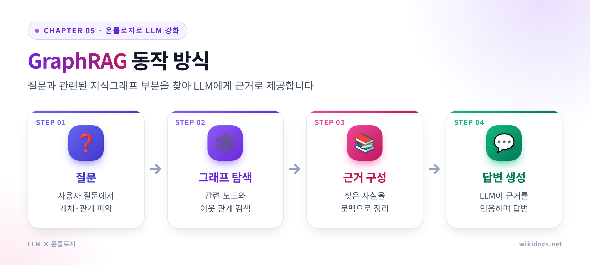

<!--
**상태**: 🔵 검토 중
**분류**: 05. 온톨로지로 LLM 강화
**태그**: #LLM #RAG #GraphRAG
**작성일**: 2026-11-22
-->
> 📅 **최종 확인**: 2026-11-22

RAG(검색 증강 생성)는 LLM이 답하기 전에 관련 자료를 찾아 주는 방법입니다. 일반 RAG는 **비슷한 문장**을 찾아 주지만, 여러 단계의 관계를 따라가야 하는 질문에는 약합니다. **GraphRAG**는 지식그래프에서 **관계를 따라** 근거를 모아 LLM에게 줍니다.

[TOC]

## 요약

- GraphRAG는 **질문 → 개체 찾기 → 그래프 탐색 → 근거 구성 → 답변 생성** 순서로 동작합니다.
- "A의 공급사의 경쟁사"처럼 **여러 단계 관계**가 필요한 질문에 특히 강합니다.
- 근거에 번호를 붙여 LLM이 **인용하며 답하게** 하면, 답을 검증하기 쉬워집니다.

## 동작 방식



## 일반 RAG와 GraphRAG

| 질문 | 일반 RAG | GraphRAG |
|---|---|---|
| "B소재는 어떤 회사야?" | ✅ 회사 소개 문서를 잘 찾음 | ✅ |
| "A전자 공급망에 문제가 생기면 영향받는 회사는?" | ⚠️ "A전자"가 들어간 문서만 찾음, 2단계 공급사(D화학)를 놓치기 쉬움 | ✅ 공급 관계를 따라 D화학, C전자까지 찾음 |
| "전자 산업 회사들의 공급사 목록" | ⚠️ 여러 문서에 흩어진 정보를 모으기 어려움 | ✅ 산업 → 회사 → 공급사 관계로 정확히 모음 |

[[TIP("알아두기")]]

"GraphRAG"라는 이름은 Microsoft가 2024년 공개한, 문서에서 그래프와 주제 요약을 만들어 검색하는 방법을 가리킬 때도 쓰입니다. 이 페이지는 더 넓은 의미에서 **지식그래프를 검색 근거로 쓰는 방법 전체**를 다룹니다.

[[/TIP]]

## 코드: 근거 구성까지 직접 만들기

LLM을 호출하기 직전까지(근거 구성과 프롬프트 생성)를 실제로 실행합니다. 전체 코드는 `code/08_graphrag.py`입니다.

**질문:** A전자의 공급망에 문제가 생기면 영향을 받을 수 있는 다른 회사는?

### 1단계: 개체 찾기

```python
classes = set(g.subjects(RDF.type, OWL.Class))
hits = {str(o): s for s, _, o in g.triples((None, RDFS.label, None))
        if str(o) in QUESTION and s not in classes}
entities = [node for name, node in hits.items()
            if not any(name != other and name in other for other in hits)]
```

```text
1) 찾은 개체: ['A전자']
```

[[TIP("주의: 이름 매칭의 함정")]]

처음에는 질문에 들어 있는 이름을 단순히 찾게 했더니 **"회사"(클래스)와 "전자"(A전자 안의 글자)**까지 찾아냈습니다. 그래서 ① 클래스는 빼고 ② 더 긴 이름에 포함된 짧은 이름은 빼도록 고쳤습니다. 실무에서는 동의어(SKOS altLabel)와 LLM을 함께 써서 개체를 찾는 경우가 많습니다.

[[/TIP]]

### 2단계: 그래프 탐색 (2단계 이웃)

온톨로지에 정의된 **관계만** 따라가며, 찾은 개체에서 2단계까지의 사실을 모읍니다.

```python
RELATIONS = set(g.subjects(RDF.type, OWL.ObjectProperty))
facts, frontier = set(), set(entities)
for hop in range(2):
    nxt = set()
    for node in frontier:
        for s, p, o in list(g.triples((node, None, None))) + list(g.triples((None, None, node))):
            if p in RELATIONS:
                facts.add((s, p, o)); nxt.update({s, o})
    frontier = nxt - frontier
```

### 3단계: 근거 구성

```text
2) 모은 사실: 11개
3) 근거:
[1] A전자 -경쟁한다→ C전자
[2] A전자 -만든다→ 스마트폰 X
[3] A전자 -속한 산업→ 전자
[4] B소재 -공급한다→ A전자
[5] B소재 -만든다→ 양극재 Y
[6] B소재 -속한 산업→ 2차전지 소재
[7] C전자 -속한 산업→ 전자
[8] D화학 -공급한다→ B소재
[9] D화학 -공급한다→ C전자
[10] 김민준 -근무한다→ A전자
[11] 이서연 -근무한다→ B소재
```

### 4단계: 프롬프트 만들기

```text
아래 [근거]만 사용해 질문에 답해 줘. 문장마다 근거 번호를 [1]처럼 붙이고,
근거로 답할 수 없는 부분은 "근거 없음"이라고 써 줘.

[근거]
[1] A전자 -경쟁한다→ C전자
... (위 11개)

[질문]
A전자의 공급망에 문제가 생기면 영향을 받을 수 있는 다른 회사는?
```

### 기대하는 답의 모양

이 근거로 LLM이 답하면 다음과 같은 형태가 됩니다. (설명을 위한 예시이며, 실제 답은 모델에 따라 다릅니다)

```text
A전자에 직접 공급하는 B소재가 영향을 받을 수 있습니다 [4].
B소재에 공급하는 D화학도 영향을 받을 수 있으며 [8],
D화학은 A전자의 경쟁사인 C전자에도 공급하므로 [9][1],
D화학을 통해 C전자까지 간접 영향이 이어질 수 있습니다.
```

일반 RAG였다면 놓치기 쉬운 **"D화학을 거쳐 경쟁사 C전자까지"**라는 연결을 근거 번호와 함께 설명할 수 있습니다.

## 실무 팁

| 상황 | 방법 |
|---|---|
| 근거가 너무 많음 | 관계 종류별 우선순위를 정하거나, 질문과 관련된 관계만 탐색 |
| 개체를 못 찾음 | SKOS 동의어 사전 사용, LLM으로 질문 속 개체 추출 |
| 문서 내용도 필요 | 그래프 근거 + 일반 RAG 문서 근거를 함께 제공 (하이브리드) |

## 실무 체크포인트

- [ ] 개체 찾기에서 클래스·부분 문자열 오류를 막았는가
- [ ] 탐색 깊이와 관계 종류를 질문 유형에 맞게 정했는가
- [ ] 근거에 번호를 붙이고 인용하며 답하게 했는가

## 근거·출처

| 구분 | 출처 | 비고 |
|---|---|---|
| 논문 | [From Local to Global: A Graph RAG Approach (Microsoft Research, 2024)](https://arxiv.org/abs/2404.16130) | GraphRAG |
| 도구 | [rdflib 문서](https://rdflib.readthedocs.io/) | 예제 구현 |

## 관련 페이지

- 05-1. 스키마 기반 정보 추출
- 05-3. 환각 줄이기와 근거 제시
- 📚 03-2. SPARQL 기초
- 📚 06-3. GraphRAG 성능 평가
