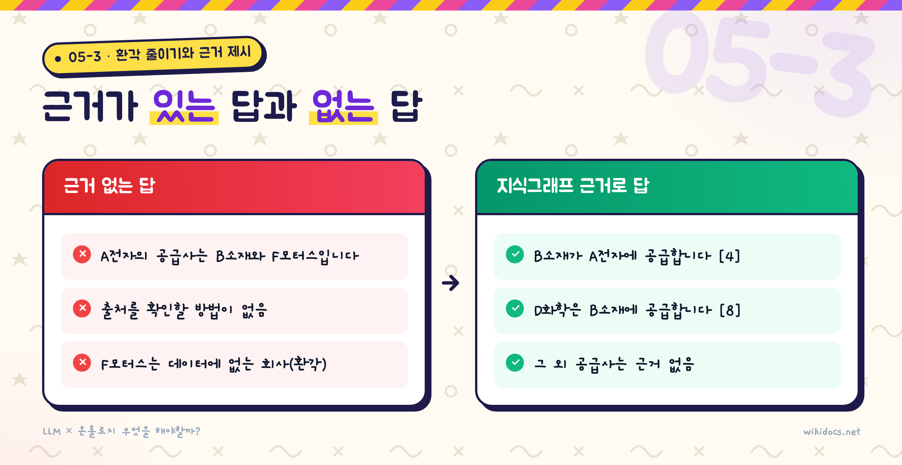

<!--
**상태**: 🔵 검토 중
**분류**: 05. 온톨로지로 LLM 강화
**태그**: #LLM #검증
**작성일**: 2026-11-22
-->
> 📅 **최종 확인**: 2026-11-22

지식그래프를 근거로 주는 것만으로 환각이 사라지지는 않습니다. LLM이 근거를 무시하거나, 근거에 없는 내용을 덧붙일 수 있기 때문입니다. 이 페이지에서는 **근거를 지키게 만드는 방법**과 **답이 근거를 지켰는지 확인하는 방법**을 정리합니다.

## 요약

- 근거에 **번호**를 붙이고, 답의 문장마다 **인용**하게 합니다.
- 근거로 답할 수 없으면 **"근거 없음"**이라고 말하게 합니다.
- 답을 받은 뒤 **인용 번호가 실제 근거와 맞는지** 다시 확인합니다.

## 근거가 있는 답과 없는 답



## 근거를 지키게 하는 프롬프트 규칙

```text
[답변 규칙]
1. 아래 [근거]에 있는 사실만 사용해.
2. 문장마다 근거 번호를 [1]처럼 붙여.
3. 근거로 답할 수 없는 부분은 "근거 없음"이라고 써. 추측하지 마.
4. 여러 근거를 이어서 추론했다면 어떤 근거를 이었는지 밝혀. (예: [4][8])
5. 일반 상식으로 보충한 내용이 있다면 "일반 정보"라고 표시해.
```

## 답을 받은 뒤 확인하기

LLM의 답을 그대로 쓰지 말고 간단한 검사를 거칩니다.

| 검사 | 방법 | 예 |
|---|---|---|
| 인용이 있는가 | 문장마다 `[숫자]`가 있는지 확인 | 인용 없는 문장 → 표시 |
| 인용 번호가 존재하는가 | 근거 목록 범위 안의 번호인지 확인 | 근거 11개인데 [15] 인용 → 오류 |
| 인용과 내용이 맞는가 | 문장 속 개체 이름이 인용한 근거에 있는지 확인 | "F모터스 [4]"인데 근거 4에 F모터스 없음 → 오류 |
| 확인이 필요한 답 | 위 검사 실패 시 | 사람 확인 또는 재질문 |

[[TIP("요령: 두 번째 LLM으로 검사하기")]]

답을 만든 LLM과 별도로, 검사용 프롬프트를 한 번 더 실행하는 방법도 있습니다. "아래 답의 각 문장이 인용한 근거로 뒷받침되는지 '예/아니오'로 판단해 줘." 다만 검사용 LLM도 틀릴 수 있으므로, 중요한 답은 사람이 최종 확인합니다.

[[/TIP]]

## 근거에도 출처 붙이기

근거로 쓰는 사실 자체가 틀렸다면 답도 틀립니다. 04-4처럼 지식그래프의 사실마다 **원래 출처**를 저장해 두면, 답 → 근거 → 원래 문서까지 거슬러 올라가 확인할 수 있습니다.

```text
답: "B소재가 A전자에 공급합니다 [4]"
근거 [4]: B소재 -공급한다→ A전자
출처: 2026-10 공시 자료 #1102, 승인 2026-10-15 (검토자 이OO)
```

## 실무 체크포인트

- [ ] 근거에 번호를 붙이고 인용하며 답하게 했는가
- [ ] "근거 없음"이라고 답할 수 있게 허용했는가
- [ ] 인용 번호와 내용이 맞는지 자동으로 확인하는가
- [ ] 근거 사실에도 원래 출처가 기록되어 있는가

## 관련 페이지

- 05-2. GraphRAG 이해와 구현
- 📚 04-4. 사람의 검토 절차 설계
- 📚 07-3. GraphRAG 성능 평가
- 📚 『AI 300% 활용법』 01-3. 환각과 검증하는 습관
