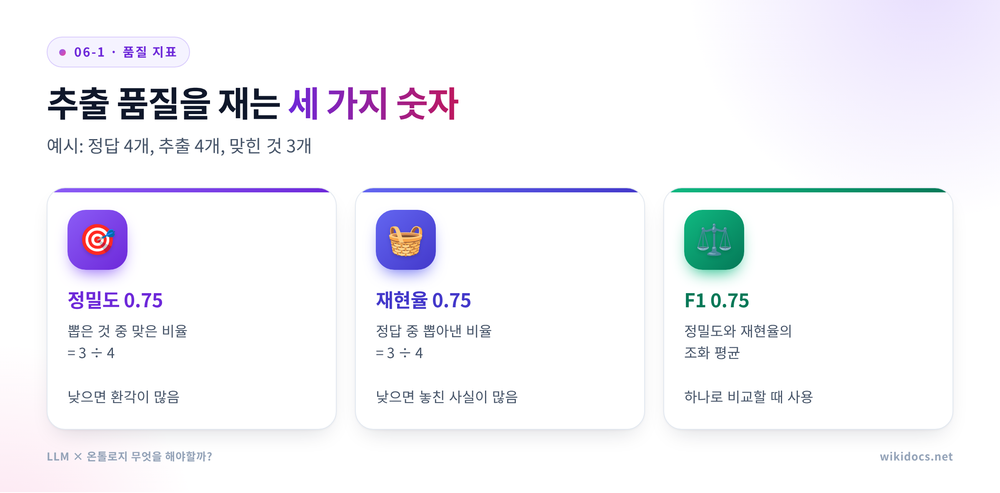

<!--
**상태**: 🔵 검토 중
**분류**: 06. 평가와 품질
**태그**: #평가
**작성일**: 2026-11-22
-->
> 📅 **최종 확인**: 2026-11-22

"LLM으로 만든 지식그래프가 얼마나 정확한가?"에 답하려면 **숫자로 재야** 합니다. 이 페이지에서는 추출 품질을 재는 기본 지표인 정밀도·재현율·F1과, 온톨로지 자체의 품질을 보는 기준을 정리합니다.

## 요약

- **정밀도**: 뽑은 사실 중 맞은 비율 → 낮으면 **환각**이 많습니다.
- **재현율**: 있어야 할 사실 중 뽑아낸 비율 → 낮으면 **놓친 사실**이 많습니다.
- 평가하려면 사람이 만든 **정답 세트**가 필요합니다. 문서 20~50개 정도로 시작합니다.

## 세 가지 숫자



## 코드: 정답과 비교하기

04-2의 예시 문서에 대해 사람이 만든 정답 4개와 LLM이 추출한 4개를 비교합니다. 전체 코드는 `code/09_evaluate.py`입니다.

```python
GOLD = {("D화학", "공급한다", "C전자"), ("B소재", "공급한다", "E배터리"),
        ("A전자", "본사 위치", "서울"), ("A전자", "만든다", "스마트폰 X")}
PRED = {("D화학", "공급한다", "C전자"), ("B소재", "공급한다", "E배터리"),
        ("A전자", "본사 위치", "서울"), ("B소재", "공급한다", "F모터스")}

tp = len(GOLD & PRED)
precision = tp / len(PRED)
recall = tp / len(GOLD)
f1 = 2 * precision * recall / (precision + recall)
```

**실행 결과**

```text
맞힌 수(TP) 3 / 추출 4 / 정답 4
정밀도 0.75 · 재현율 0.75 · F1 0.75
놓친 사실: [('A전자', '만든다', '스마트폰 X')]
틀린 사실: [('B소재', '공급한다', 'F모터스')]
```

"틀린 사실"은 환각을, "놓친 사실"은 프롬프트나 문서 처리의 빈틈을 알려 줍니다. 숫자와 함께 **어떤 사실을 틀리고 놓쳤는지**를 보는 것이 개선에 더 도움이 됩니다.

[[TIP("요령: 목적에 따라 중요한 지표가 다릅니다")]]

- 지식그래프에 **자동 반영**한다면 → **정밀도**가 중요합니다. 틀린 사실이 들어가면 안 되니까요.
- 사람이 검토할 **후보를 모은다면** → **재현율**이 중요합니다. 놓치면 검토할 기회도 없으니까요.

[[/TIP]]

## 정답 세트 만들기

| 단계 | 할 일 |
|---|---|
| 1 | 실제로 처리할 문서와 비슷한 문서 20~50개 고르기 |
| 2 | 담당자 2명이 각자 정답 트리플 작성 |
| 3 | 두 사람의 결과가 다른 부분을 토론해 기준 확정 |
| 4 | 확정한 기준을 문서로 남기고, 프롬프트에도 반영 |

두 사람의 정답이 많이 다르다면, LLM보다 **기준 자체가 모호하다**는 신호입니다.

## 온톨로지 자체의 품질 기준

| 기준 | 질문 | 확인 방법 |
|---|---|---|
| 정확성 | 정의와 관계가 실제와 맞는가 | 전문가 검토 |
| 완전성 | 역량 질문(03-4)에 모두 답할 수 있는가 | 질문별 SPARQL 실행 |
| 일관성 | 서로 모순되는 사실이 없는가 | 06-2의 검사 |
| 간결성 | 쓰이지 않는 클래스·관계가 없는가 | 사용 빈도 조회 |
| 이해 용이성 | 이름·정의가 명확한가 | 신규 담당자에게 설명해 보기 |

## 실무 체크포인트

- [ ] 사람이 만든 정답 세트가 있는가
- [ ] 정밀도·재현율과 함께 틀린·놓친 사실 목록을 보는가
- [ ] 자동 반영 여부에 따라 중요 지표를 정했는가

## 관련 페이지

- 06-2. 논리적 일관성 검사
- 06-3. GraphRAG 성능 평가
- 📚 04-2. 관계 추출과 트리플 생성
