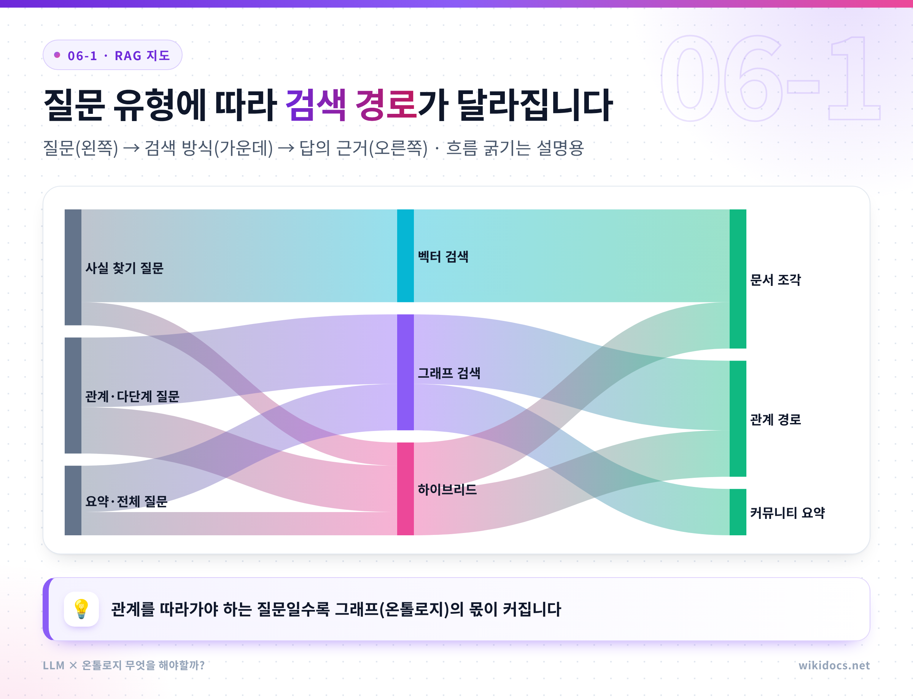
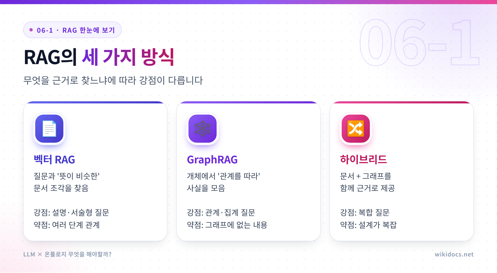

<!--
**상태**: 🔵 검토 중
**분류**: 06. RAG와 LLM 시스템 설계
**태그**: #RAG #설계
**작성일**: 2026-11-22
-->
> 📅 **최종 확인**: 2026-11-22

RAG(Retrieval-Augmented Generation, 검색 증강 생성)는 LLM이 답하기 전에 **관련 자료를 찾아 근거로 주는 방법**입니다. RAG에도 여러 방식이 있고, 온톨로지와 지식그래프는 그중 "관계"를 다루는 부분을 맡습니다. 이 페이지에서는 RAG의 세 가지 방식과 서로의 관계를 한눈에 정리합니다.

[TOC]

## 요약

- **벡터 RAG**는 "뜻이 비슷한 문서"를, **GraphRAG**는 "관계로 연결된 사실"을 찾습니다.
- 실무에서는 질문 유형에 따라 둘을 고르거나 함께 쓰는 **하이브리드**가 가장 많이 쓰입니다.
- 온톨로지는 그래프 검색의 **설계도**이자, 문서 검색의 **용어 정리(동의어·분류)**에도 쓰입니다.



## RAG의 세 가지 방식



| | 벡터 RAG | GraphRAG | 하이브리드 |
|---|---|---|---|
| 무엇을 저장 | 문서 조각 + 임베딩(숫자 벡터) | 개체·관계(트리플) | 둘 다 |
| 어떻게 찾나 | 질문과 의미가 가까운 조각 | 질문 속 개체에서 관계를 따라 | 질문 유형에 따라 선택·결합 |
| 잘하는 질문 | "양극재란 무엇인가?" | "D화학과 공급 관계로 연결된 회사는?" | "D화학 생산 차질이 A전자에 영향을 주나?" |
| 약한 질문 | 여러 단계 관계, 집계 | 그래프에 없는 서술·설명 | — (설계·운영이 복잡) |
| 준비 비용 | 낮음 (문서만 있으면 시작) | 높음 (온톨로지·추출 필요) | 가장 높음 |

## RAG와 온톨로지의 관계

온톨로지는 GraphRAG에만 쓰이는 것이 아닙니다. RAG 전체에서 다음 역할을 합니다.

| RAG 단계 | 온톨로지의 역할 | 이 책의 관련 페이지 |
|---|---|---|
| 질문 이해 | 질문 속 개체와 동의어를 표준 이름으로 바꿈 | 02-3 SKOS |
| 문서 검색 | 문서에 개념 태그를 붙여 검색 범위를 좁힘 | 04-1 개념 추출 |
| 그래프 검색 | 어떤 관계를 따라갈지 정의 | 05-2 GraphRAG |
| 답변 생성 | 허용된 용어·관계로만 답하게 함 | 05-1 스키마 기반 |
| 검증 | 답 속 사실이 그래프·규칙과 맞는지 확인 | 05-3, 07-2 |

## 예제: 같은 데이터, 세 가지 방식

이 책의 가상 회사 데이터(`company.ttl`)에 짧은 문서 5개(`docs.txt`)를 더해, 질문마다 검색 방식을 자동으로 고르는 예제를 실행합니다. 전체 코드는 `code/12_hybrid_rag.py`입니다.

[[TIP("알림")]]

실제 벡터 검색은 임베딩 모델로 문서를 숫자 벡터로 바꿔 비교합니다. 이 예제는 외부 서비스 없이 실행되도록 **글자 2개 묶음이 얼마나 겹치는지**로 비슷함을 흉내 냈습니다. 원리를 보여 주기 위한 단순화입니다.

[[/TIP]]

### 질문 1: 설명형 → 벡터 방식

```text
질문: 양극재는 무엇인가?
방식: vector
   (문서) B소재 회사 소개: B소재는 2008년 설립된 2차전지 소재 기업으로 양극재 Y를 주력으로 생산한다. ...
   (문서) 양극재 용어 설명: 양극재는 배터리의 용량과 출력을 결정하는 핵심 소재로, ...
```

### 질문 2: 관계형 → 그래프 방식

```text
질문: D화학과 공급 관계로 연결된 회사는?
방식: graph
   (그래프) D화학 -공급한다→ B소재
   (그래프) D화학 -공급한다→ C전자
   (그래프) B소재 -공급한다→ A전자
   ... (총 8개 사실)
```

### 질문 3: 복합형 → 하이브리드

```text
질문: D화학의 생산 차질이 A전자에 영향을 줄 수 있는지, 관련 소식과 함께 설명해 줘
방식: hybrid
   (문서) D화학 실적 기사: ... 공장 설비 점검으로 일부 생산 라인이 2주간 멈출 예정이라고 밝혔다.
   (문서) A전자 신제품 기사: ...
   (그래프) D화학 -공급한다→ B소재
   (그래프) B소재 -공급한다→ A전자
   ... (문서 2개 + 사실 12개)
```

질문 3은 **문서만으로는** "D화학 → B소재 → A전자"라는 2단계 공급 관계를 알 수 없고, **그래프만으로는** "2주간 생산 중단"이라는 최신 소식을 알 수 없습니다. 둘을 합쳐야 "D화학의 생산 중단이 B소재를 거쳐 A전자에 영향을 줄 수 있다"는 답의 근거가 모두 갖춰집니다.

## 라우터: 어떤 방식으로 찾을지 정하기

예제의 라우터는 질문에 "공급·경쟁·영향" 같은 관계 단어가 있으면 그래프, "무엇·설명·소개" 같은 단어가 있으면 문서, 둘 다 있으면 하이브리드를 고릅니다.

```python
def route(q: str) -> str:
    relation_words = ["공급", "경쟁", "영향", "관계", "거래"]
    describe_words = ["무엇", "설명", "소개", "특징", "계획"]
    r, d = any(w in q for w in relation_words), any(w in q for w in describe_words)
    return "hybrid" if r and d else "graph" if r else "vector"
```

실무에서는 이 판단을 **작고 빠른 LLM**에게 맡기는 경우가 많습니다(06-5). 이때도 "관계 단어 목록"은 온톨로지의 관계 이름과 동의어에서 가져오면 일관성이 생깁니다.

## 어떤 방식부터 시작할까

| 우리 상황 | 추천 출발점 |
|---|---|
| 문서는 많고, 질문 대부분이 "~란?", "~방법은?" | 벡터 RAG부터 |
| 질문 대부분이 "누가·무엇과 연결", "몇 개", "영향은?" | 핵심 관계만 담은 작은 그래프부터 |
| 둘 다 중요 | 벡터 RAG로 시작 → 자주 틀리는 관계형 질문을 모아 그래프 추가 |

## 실무 체크포인트

- [ ] 실제 질문을 설명형·관계형·복합형으로 분류해 봤는가
- [ ] 질문 유형에 맞는 검색 방식을 골랐는가
- [ ] 라우터의 판단 기준을 온톨로지의 관계·동의어와 연결했는가

## 근거·출처

| 구분 | 출처 | 비고 |
|---|---|---|
| 논문 | [Retrieval-Augmented Generation for Knowledge-Intensive NLP Tasks (Lewis et al., 2020)](https://arxiv.org/abs/2005.11401) | RAG 원 논문 |
| 논문 | [From Local to Global: A Graph RAG Approach (Microsoft Research, 2024)](https://arxiv.org/abs/2404.16130) | GraphRAG |
| 논문 | [Unifying Large Language Models and Knowledge Graphs: A Roadmap (Pan et al., 2023)](https://arxiv.org/abs/2306.08302) | LLM과 지식그래프 결합 방향 |

## 관련 페이지

- 06-4. 원하는 시스템을 만드는 설계 방법
- 06-5. 역할별 LLM 모델 활용법
- 📚 05-2. GraphRAG 이해와 구현
- 📚 07-3. GraphRAG 성능 평가
