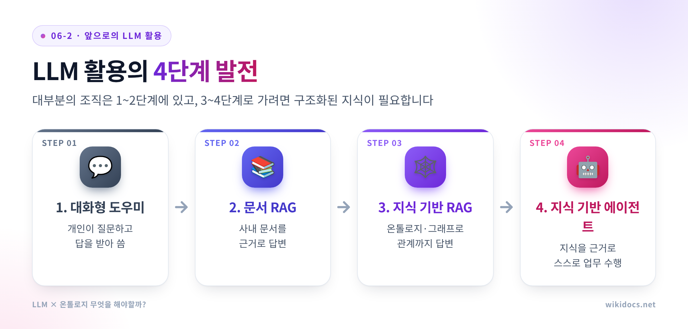

<!--
**상태**: 🔵 검토 중
**분류**: 06. RAG와 LLM 시스템 설계
**태그**: #LLM #전략
**작성일**: 2026-11-22
-->
> 📅 **최종 확인**: 2026-11-22

LLM 활용은 "개인이 질문하고 답을 받는" 단계에서 "조직의 지식을 근거로 AI가 업무를 수행하는" 단계로 옮겨 가고 있습니다. 이 페이지에서는 그 흐름을 4단계로 정리하고, 단계마다 **무엇을 준비해야 하는지** 예시와 함께 살펴봅니다.

## 요약

- LLM 활용은 **대화형 도우미 → 문서 RAG → 지식 기반 RAG → 지식 기반 에이전트**로 발전합니다.
- 단계가 올라갈수록 **모델 성능보다 "구조화된 지식"과 "검증 체계"**가 결과를 좌우합니다.
- 지금 할 일은 **우리 조직이 어느 단계인지 확인하고, 다음 단계의 준비물**을 갖추는 것입니다.

## LLM 활용의 4단계



| 단계 | 모습 | 예시 | 한계 |
|---|---|---|---|
| 1. 대화형 도우미 | 개인이 AI에게 묻고 답을 복사해 씀 | 이메일 초안, 요약 | 회사 내부 사정을 모름 |
| 2. 문서 RAG | 사내 문서를 근거로 답함 | "출장비 규정 알려 줘" | 여러 문서에 흩어진 관계를 잇지 못함 |
| 3. 지식 기반 RAG | 온톨로지·지식그래프로 관계까지 답함 | "이 부품 공급이 끊기면 영향받는 제품은?" | 답만 하고 행동은 사람이 |
| 4. 지식 기반 에이전트 | 지식을 근거로 여러 단계 업무를 수행 | 공급 차질 감지 → 영향 분석 → 대체 공급사 후보 → 담당자 보고 | 권한·승인·감사 체계 필요 |

## 예시: 같은 질문이 단계별로 어떻게 달라지나

**질문:** "D화학 공장이 2주간 멈춘다는데, 우리(A전자)는 괜찮을까?"

```text
[1단계] "공급망 차질에 대비하려면 재고 확인, 대체 공급사 검토가 필요합니다." (일반론)

[2단계] "D화학 실적 기사에 따르면 2주간 일부 생산 라인이 멈춥니다." (문서는 찾지만 우리와의 관계는 모름)

[3단계] "D화학은 B소재에 공급하고 [8], B소재는 A전자에 공급합니다 [4].
         따라서 B소재를 거쳐 A전자에 간접 영향이 있을 수 있습니다." (관계를 따라 근거 제시)

[4단계] 위 분석에 더해 → B소재의 재고 현황 조회 → 대체 소재 공급사 후보 2곳 정리
         → 구매팀장에게 보고서 초안 작성 후 "발송 전 확인" 요청 (사람 승인 후 실행)
```

3단계부터는 **"D화학 → B소재 → A전자"라는 관계 지식**이 있어야 가능합니다. 이 지식이 바로 온톨로지와 지식그래프입니다. 05-2와 06-1의 예제가 3단계를, 05-4가 4단계를 보여 줍니다.

## 앞으로 달라지는 점

| 흐름 | 의미 | 준비할 것 |
|---|---|---|
| 모델은 계속 좋아지고 바뀜 | 특정 모델에 맞춘 시스템은 오래 못 감 | 모델을 바꿔 끼울 수 있는 구조 (06-4) |
| 여러 모델을 함께 씀 | 일마다 알맞은 모델을 배치 | 역할별 모델 설계 (06-5) |
| AI가 도구를 직접 사용 | 사내 시스템과 연결 표준이 중요 | MCP 등 연결 표준 (05-4) |
| 근거와 책임을 요구받음 | "왜 그렇게 답했나"를 설명해야 함 | 근거 인용, 기록 (05-3, 04-4) |
| AI 관련 법·제도 시행 | 투명성·위험 관리 요구 증가 | 거버넌스 설계 (06-3) |

[[TIP("핵심")]]

모델은 몇 달마다 바뀌지만, **잘 정리된 조직의 지식(온톨로지·지식그래프·평가 세트)**은 어떤 모델로 바꿔도 그대로 쓸 수 있습니다. 앞으로의 경쟁력은 "어떤 모델을 쓰느냐"보다 **"모델에게 어떤 지식을 주느냐"**에서 나옵니다.

[[/TIP]]

## 우리 조직 단계 진단

| 질문 | 예 → |
|---|---|
| 직원들이 개인적으로 AI를 쓰고 있는가? | 1단계 이상 |
| 사내 문서를 근거로 답하는 AI가 있는가? | 2단계 이상 |
| 핵심 업무 개념·관계를 정리한 온톨로지가 있는가? | 3단계 준비 |
| AI가 사내 시스템을 조회·실행하고, 승인·기록 체계가 있는가? | 4단계 준비 |

## 실무 체크포인트

- [ ] 우리 조직의 현재 단계를 진단했는가
- [ ] 다음 단계에 필요한 준비물(문서 정리, 온톨로지, 승인 체계)을 정했는가
- [ ] 특정 모델에 묶이지 않는 구조를 고려하고 있는가

## 근거·출처

| 구분 | 출처 | 비고 |
|---|---|---|
| 논문 | [Unifying Large Language Models and Knowledge Graphs: A Roadmap (Pan et al., 2023)](https://arxiv.org/abs/2306.08302) | LLM·지식그래프 결합 유형 |
| 표준 | [Model Context Protocol](https://modelcontextprotocol.io/) | AI와 도구 연결 |

## 관련 페이지

- 06-3. 온톨로지 구축이 더 중요해지는 이유
- 06-4. 원하는 시스템을 만드는 설계 방법
- 📚 05-4. 온톨로지 기반 AI 에이전트
- 📚 『AI 300% 활용법』 07-1. AI 에이전트란
