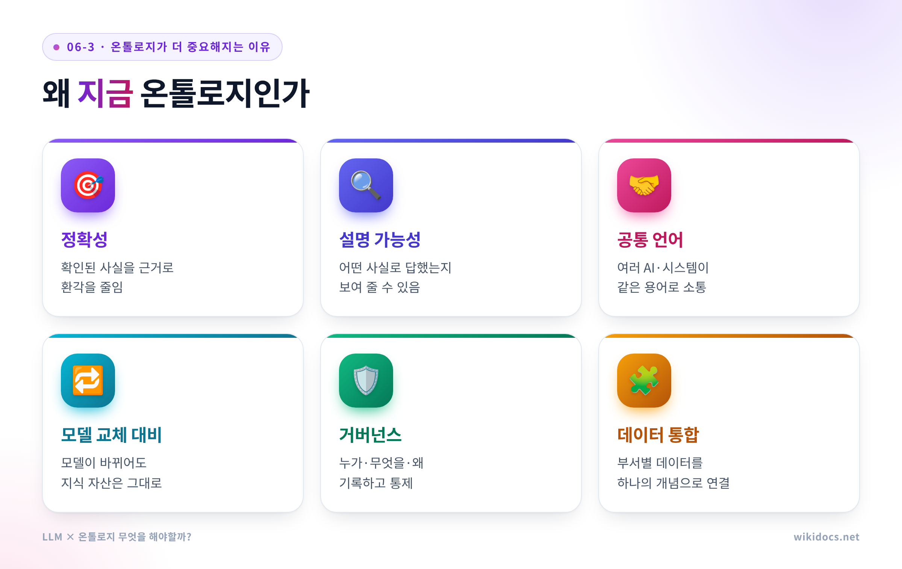

<!--
**상태**: 🔵 검토 중
**분류**: 06. RAG와 LLM 시스템 설계
**태그**: #온톨로지 #전략
**작성일**: 2026-11-22
-->
> 📅 **최종 확인**: 2026-11-22

"LLM이 이렇게 똑똑한데, 굳이 온톨로지를 만들어야 하나요?" 자주 받는 질문입니다. 답은 반대입니다. **LLM이 업무 깊숙이 들어올수록 온톨로지가 더 중요해집니다.** 이 페이지에서는 그 이유를 여섯 가지로 정리하고, 구축을 시작하는 현실적인 방법을 제시합니다.

## 요약

- 온톨로지는 LLM에게 **정확한 사실, 설명 가능한 근거, 조직의 공통 언어**를 줍니다.
- 모델이 바뀌어도 남는 **오래가는 자산**이며, AI 거버넌스의 기반이 됩니다.
- 처음부터 크게 만들지 말고, **가장 가치 있는 질문 하나**에서 시작해 키워 갑니다.

## 왜 지금 온톨로지인가



| 이유 | LLM만 쓸 때 | 온톨로지가 있을 때 | 예시 |
|---|---|---|---|
| 정확성 | 그럴듯하지만 틀린 관계를 말함 | 확인된 사실만 근거로 | "B소재가 F모터스에 공급" 같은 환각 차단 (04-2) |
| 설명 가능성 | 왜 그렇게 답했는지 모름 | 사용한 사실(트리플)을 제시 | 답변 문장마다 근거 번호 (05-3) |
| 공통 언어 | 부서·시스템마다 용어가 다름 | 같은 개념을 같은 이름으로 | "협력사 = 공급업체" 매핑 (04-3) |
| 모델 교체 대비 | 프롬프트·튜닝을 다시 해야 함 | 지식은 그대로, 모델만 교체 | 새 모델로 바꿔도 같은 그래프 사용 |
| 거버넌스 | 누가 무엇을 넣었는지 추적 불가 | 사실마다 출처·승인 기록 | 검토 기록 (04-4) |
| 데이터 통합 | 데이터가 시스템별로 흩어짐 | 개념 중심으로 연결 | 회사 ID 하나로 재무·공급·뉴스 연결 |

## 앞으로 더 중요해지는 이유: 여러 AI가 함께 일할 때

에이전트가 여러 개 생기면(예: 구매 에이전트, 재무 에이전트, 고객 응대 에이전트), 각자 다른 뜻으로 같은 단어를 쓰는 순간 문제가 생깁니다.

```text
구매 에이전트: "주요 공급사" = 거래 금액 상위 10곳
재무 에이전트: "주요 공급사" = 미지급금이 있는 곳
→ 같은 질문에 서로 다른 답, 사람도 원인을 찾기 어려움

온톨로지에서 "주요 공급사"를 한 번 정의 → 모든 에이전트가 같은 정의를 사용
```

온톨로지는 **AI들 사이의 계약서**가 됩니다. 05-4에서 본 것처럼 지식그래프를 도구(MCP 등)로 공유하면, 어떤 AI 앱에서도 같은 정의와 같은 사실을 쓰게 됩니다.

## 규제와 책임 측면

AI에 대한 투명성과 위험 관리 요구도 커지고 있습니다. 한국에서는 「인공지능 발전과 신뢰 기반 조성 등에 관한 기본법」(AI 기본법)이 2026년 1월 22일 시행되었고, 정부는 투명성 확보와 고영향 인공지능 판단 등에 관한 가이드라인을 발표했습니다. 어떤 의무가 우리 서비스에 해당하는지는 법령과 가이드라인 원문으로 확인해야 하지만, **"AI가 무엇을 근거로 판단했는지 설명할 수 있는 구조"**는 어떤 경우에도 도움이 됩니다.

[[TIP("주의")]]

이 페이지는 법률 자문이 아닙니다. 서비스가 법적 의무 대상인지는 법령 원문, 관계 부처 가이드라인, 법률 전문가를 통해 확인하세요.

[[/TIP]]

## 현실적인 구축 방법: 작게 시작해 키우기

| 단계 | 할 일 | 기간 예시 | 결과물 |
|---|---|---|---|
| 1. 가치 있는 질문 고르기 | LLM이 자주 틀리거나 답 못 하는 관계형 질문 10개 | 1주 | 역량 질문 목록 (03-4) |
| 2. 최소 온톨로지 | 그 질문에 필요한 클래스 5~10개, 관계 5~10개 | 1~2주 | `ontology.ttl` |
| 3. 데이터 채우기 | 기존 DB + LLM 추출 + 사람 검토 | 2~4주 | 지식그래프 |
| 4. RAG에 연결 | 하이브리드 RAG로 질문 10개 시험 | 1~2주 | 평가 결과 (07-3) |
| 5. 넓히기 | 효과가 확인되면 질문·관계 추가 | 계속 | 확장된 온톨로지 |

**자주 하는 실수:** 전사 표준 온톨로지를 처음부터 완성하려다 1년 넘게 결과물이 없는 경우입니다. **질문 하나를 해결하는 작은 온톨로지**가 큰 계획서보다 설득력이 있습니다.

## 실무 체크포인트

- [ ] 온톨로지로 해결할 가치 있는 질문을 골랐는가
- [ ] 여러 부서·AI가 함께 쓸 핵심 용어의 정의를 정했는가
- [ ] 사실마다 출처와 승인 기록을 남기는 구조인가
- [ ] AI 관련 법·가이드라인 적용 여부를 확인했는가

## 근거·출처

| 구분 | 출처 | 비고 |
|---|---|---|
| 법령 | [인공지능 발전과 신뢰 기반 조성 등에 관한 기본법 (국가법령정보센터)](https://www.law.go.kr/LSW/lsRvsDocInfoR.do?lsiSeq=282791) | 2026.1.22. 시행 |
| 보도 | [AI 기본법 시행 관련 보도 (디지털데일리, 2026.1.)](https://www.ddaily.co.kr/page/view/2026012112024216108) | 시행 시점·업계 대응 |
| 논문 | [Unifying Large Language Models and Knowledge Graphs: A Roadmap (Pan et al., 2023)](https://arxiv.org/abs/2306.08302) | 지식그래프로 LLM 강화 |

## 관련 페이지

- 06-2. 앞으로 LLM을 어떻게 활용할까
- 06-4. 원하는 시스템을 만드는 설계 방법
- 📚 03-4. 지식그래프 모델링 실습
- 📚 04-4. 사람의 검토 절차 설계
