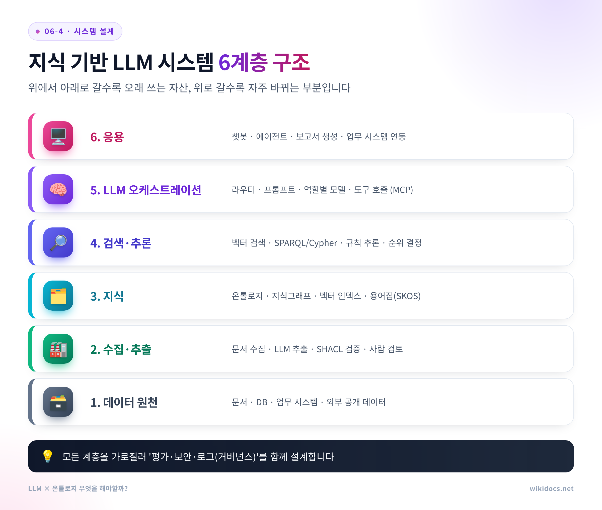

<!--
**상태**: 🔵 검토 중
**분류**: 06. RAG와 LLM 시스템 설계
**태그**: #설계 #아키텍처
**작성일**: 2026-11-22
-->
> 📅 **최종 확인**: 2026-11-22

"우리가 원하는 AI 시스템"을 만들려면 모델부터 고르지 말고 **요구사항 → 계층별 설계 → 결정 기록** 순서로 접근해야 합니다. 이 페이지에서는 지식 기반 LLM 시스템을 6계층으로 나누고, 실제 예시(공급망 리스크 질의응답 시스템)로 설계 과정을 따라갑니다.

[TOC]

## 요약

- 시스템을 **6계층**(데이터 원천 → 수집·추출 → 지식 → 검색·추론 → LLM 오케스트레이션 → 응용)으로 나눠 설계합니다.
- 아래 계층(데이터·지식)은 **오래 쓰는 자산**, 위 계층(모델·화면)은 **자주 바뀌는 부분**입니다.
- 설계는 **요구사항에서 출발**하고, 중요한 결정은 이유와 함께 **기록**합니다.

## 6계층 구조



| 계층 | 하는 일 | 이 책의 관련 내용 | 바뀌는 빈도 |
|---|---|---|---|
| 6. 응용 | 사용자가 쓰는 챗봇·에이전트·보고서 | 05-4, 08장 | 자주 |
| 5. LLM 오케스트레이션 | 라우터, 프롬프트, 역할별 모델, 도구 호출 | 05-1, 06-5 | 자주 |
| 4. 검색·추론 | 벡터 검색, SPARQL, 규칙 추론, 결과 순위 | 03-2, 05-2, 06-1 | 가끔 |
| 3. 지식 | 온톨로지, 지식그래프, 벡터 인덱스, 용어집 | 01~03장 | 천천히 (자산) |
| 2. 수집·추출 | 문서 수집, LLM 추출, SHACL 검증, 사람 검토 | 04장, 02-4 | 가끔 |
| 1. 데이터 원천 | 문서, DB, 업무 시스템, 공개 데이터 | — | 원천에 따라 |
| 공통: 거버넌스 | 평가, 권한·보안, 로그, 출처 기록 | 07장, 04-4 | 계속 |

## 설계 4단계

```text
1. 요구사항 정리   누가, 어떤 질문을, 얼마나 정확하게, 얼마나 빨리 답해야 하나
2. 계층별 설계     6계층마다 무엇을 쓸지 결정
3. 결정 기록       중요한 선택과 그 이유, 대안을 기록
4. 작게 만들어 평가 핵심 질문 10개로 시범 구축 → 평가 → 확장
```

## 예시: 공급망 리스크 질의응답 시스템 설계

### 1단계: 요구사항

| 항목 | 내용 |
|---|---|
| 사용자 | 구매팀 15명, 경영기획팀 5명 |
| 대표 질문 | "○○사에 문제가 생기면 영향받는 우리 제품은?", "이번 주 공급사 관련 뉴스와 영향 요약" |
| 정확도 | 공급 관계는 틀리면 안 됨 → 근거 없는 답 금지 |
| 속도 | 일반 질문 10초 이내, 보고서 생성은 몇 분 허용 |
| 보안 | 계약 금액은 구매팀만 조회, 외부 AI 서비스에 계약 원문 전송 금지 |
| 데이터 | 구매 DB(공급 관계), 계약서, 업계 뉴스 |

### 2단계: 계층별 설계

| 계층 | 설계 결정 |
|---|---|
| 1. 원천 | 구매 DB(매일 동기화), 계약서(문서 저장소), 뉴스(하루 2회 수집) |
| 2. 수집·추출 | DB의 공급 관계는 **그대로 변환**(LLM 불필요), 뉴스는 LLM으로 회사·사건 추출 → SHACL 검사 → 새 회사만 사람 검토 |
| 3. 지식 | 온톨로지: 회사·제품·부품·공급한다·사용한다 (이 책 `company.ttl` 확장), 뉴스 문서는 벡터 인덱스 |
| 4. 검색·추론 | 관계형 질문은 SPARQL(공급망 `+` 경로), 뉴스는 벡터 검색, 복합 질문은 하이브리드 (06-1) |
| 5. 오케스트레이션 | 라우터=작은 모델, 답변=범용 모델, 검증=다른 모델 (06-5), 근거 번호 인용 필수 (05-3) |
| 6. 응용 | 사내 메신저 챗봇 + 매주 월요일 공급 리스크 보고서 자동 생성 |
| 거버넌스 | 질문·근거·답변 로그 보관, 계약 정보는 권한별 필터, 월 1회 평가 세트(30문항) 실행 |

[[TIP("요령: LLM이 필요 없는 곳에는 쓰지 않기")]]

위 설계에서 구매 DB의 공급 관계는 **이미 구조화된 데이터**이므로 LLM으로 추출할 필요가 없습니다. 규칙으로 변환하는 편이 정확하고 저렴합니다. LLM은 **비정형 데이터(뉴스·문서)를 구조화할 때**와 **사람의 말로 답할 때** 가장 가치가 큽니다.

[[/TIP]]

### 3단계: 결정 기록 (예시)

중요한 결정은 나중에 "왜 이렇게 했지?"라는 질문에 답할 수 있도록 남깁니다.

```text
[결정 004] 지식 저장소로 트리플스토어 대신 그래프DB 선택
- 날짜: 2026-11-22
- 배경: 공급 관계에 거래 비중·시작일 같은 속성을 많이 붙여야 함
- 선택: 그래프DB (관계에 속성 부여가 쉬움, 03-1)
- 대안: 트리플스토어 + 관계 노드 → 표준 연계는 좋지만 모델이 복잡해짐
- 다시 볼 조건: 외부 공개 데이터(RDF)와 연계가 중요해지면 재검토
```

### 4단계: 작게 만들어 평가

| 주차 | 범위 | 확인할 것 |
|---|---|---|
| 1~2주 | 공급사 20곳, 질문 10개 | 관계형 질문 정답률 |
| 3~4주 | 뉴스 연결, 하이브리드 | 복합 질문 정답률, 인용 정확성 (07-3) |
| 5~6주 | 구매팀 5명 시범 사용 | 실제 질문 수집, 틀린 답 원인 분류 |

## 실무 체크포인트

- [ ] 사용자·질문·정확도·속도·보안 요구사항을 적었는가
- [ ] 6계층마다 설계 결정을 했는가
- [ ] LLM이 꼭 필요한 곳과 아닌 곳을 구분했는가
- [ ] 중요한 결정을 이유·대안과 함께 기록했는가
- [ ] 작은 범위로 시작해 평가하는 계획이 있는가

## 근거·출처

| 구분 | 출처 | 비고 |
|---|---|---|
| 논문 | [From Local to Global: A Graph RAG Approach (Microsoft Research, 2024)](https://arxiv.org/abs/2404.16130) | 그래프 기반 검색 구조 |
| 표준 | [SPARQL 1.1 Query Language (W3C)](https://www.w3.org/TR/sparql11-query/) | 그래프 질의 |
| 표준 | [Shapes Constraint Language (SHACL) (W3C)](https://www.w3.org/TR/shacl/) | 추출 데이터 검증 |
| 표준 | [Model Context Protocol](https://modelcontextprotocol.io/) | 도구 연결 |

## 관련 페이지

- 06-5. 역할별 LLM 모델 활용법
- 06-6. 설계 원칙과 체크리스트
- 📚 03-1. 트리플스토어 vs 그래프 데이터베이스
- 📚 08-1. 금융 온톨로지 구축
