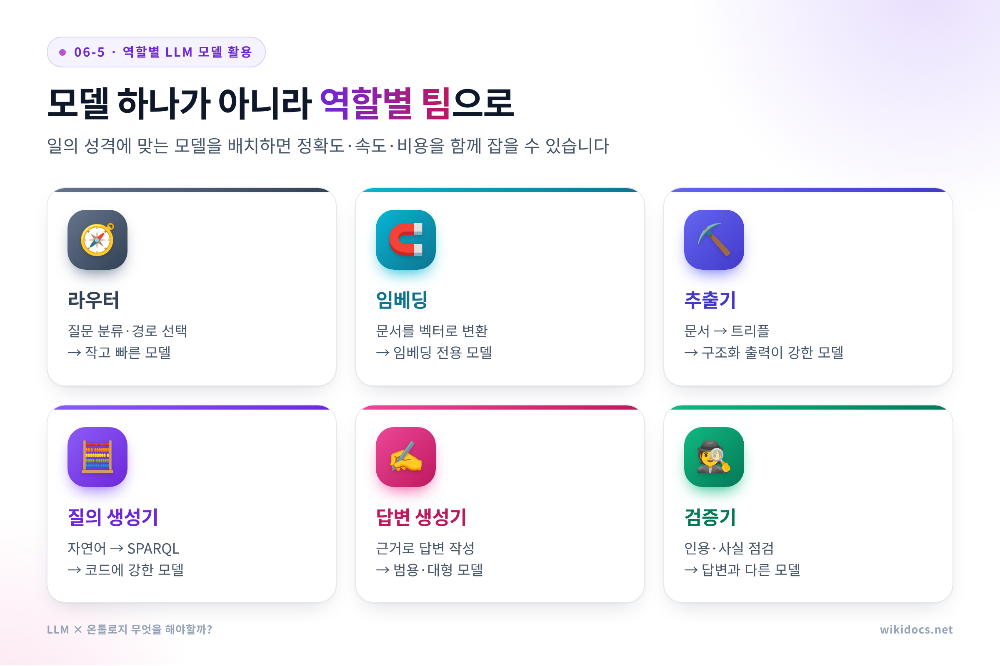

<!--
**상태**: 🔵 검토 중
**분류**: 06. RAG와 LLM 시스템 설계
**태그**: #LLM #모델
**작성일**: 2026-11-22
-->
> 📅 **최종 확인**: 2026-11-22

지식 기반 LLM 시스템에서는 **모델 하나가 모든 일을 하지 않습니다.** 질문 분류, 문서 임베딩, 트리플 추출, 질의 생성, 답변 작성, 검증은 성격이 서로 달라서 알맞은 모델도 다릅니다. 이 페이지에서는 역할별로 어떤 특징의 모델을 배치하면 좋은지 정리합니다.

## 요약

- 일을 **역할**로 나누고, 역할마다 **필요한 능력**(속도, 구조화 출력, 긴 문맥, 추론)을 정합니다.
- **답변 생성과 검증에는 서로 다른 모델**을 쓰면 같은 실수를 반복할 가능성이 줄어듭니다.
- 모델 이름이 아니라 **역할과 평가 기준**으로 설계하면, 새 모델이 나와도 쉽게 바꿀 수 있습니다.

## 역할별 팀 구성



| 역할 | 하는 일 | 필요한 능력 | 알맞은 모델 특징 | 이 책의 예 |
|---|---|---|---|---|
| 라우터 | 질문 유형 분류, 경로 선택 | 빠름, 저렴, 분류 정확도 | 작고 빠른 모델 | 06-1 `route()` |
| 임베딩 | 문서·질문을 벡터로 변환 | 의미 유사도, 한국어 품질 | 임베딩 전용 모델 | 06-1 벡터 검색 |
| 추출기 | 문서 → 트리플(JSON) | 구조화 출력, 지시 준수 | 중형 이상, JSON 스키마 지원 | 04-2, 05-1 |
| 질의 생성기 | 자연어 → SPARQL·Cypher | 코드 생성, 스키마 이해 | 코드에 강한 모델 | 03-2 |
| 답변 생성기 | 근거로 자연스러운 답 작성 | 긴 문맥, 문장력, 인용 준수 | 범용·대형 모델 | 05-2, 05-3 |
| 검증기 | 인용·사실·규칙 점검 | 비판적 판단 | 답변기와 **다른** 모델 또는 규칙 코드 | 05-3, 07-2 |
| 오프라인 처리 | 대량 문서 일괄 추출 | 처리량, 비용 | 배치 처리용 저렴한 모델 | 04장 |

## 모델을 고를 때 보는 특징

| 특징 | 질문 | 어떤 역할에 중요 |
|---|---|---|
| 크기·추론 능력 | 복잡한 판단을 잘하는가 | 답변, 검증, 질의 생성 |
| 속도·비용 | 1건에 몇 초, 얼마인가 | 라우터, 대량 추출 |
| 컨텍스트 창 | 근거를 얼마나 많이 넣을 수 있나 | 답변 (근거가 많을 때) |
| 구조화 출력 | JSON 형식을 정확히 지키나 | 추출, 라우터 |
| 한국어 품질 | 우리 문서·용어를 잘 이해하나 | 임베딩, 추출, 답변 |
| 배포 방식 | 외부 API인가, 직접 설치(오픈 모델)인가 | 민감 데이터 처리 |

[[TIP("요령: 민감한 데이터는 배포 방식부터")]]

계약서·개인정보처럼 외부로 보내기 어려운 데이터는 모델 성능보다 **배포 방식**을 먼저 정해야 합니다. 직접 설치하는 오픈 모델이나 기업용 보안 조건의 서비스를 추출 단계에 쓰고, 일반 질문 답변에는 다른 모델을 쓰는 식으로 **역할마다 다른 배포 방식**을 섞을 수 있습니다.

[[/TIP]]

## 예시: 한 질문이 처리되는 과정

**질문:** "D화학 생산 차질이 우리 제품에 영향을 주나?"

```text
① 라우터 (작은 모델)      → "복합형 질문: hybrid"                      0.5초
② 임베딩 + 벡터 검색       → D화학 관련 뉴스 2건                        0.3초
③ 질의 생성기 (코드 모델)  → SPARQL: ?s ex:suppliesTo+ ex:AElec ...     1초
   → 실행 결과: D화학 → B소재 → A전자
④ 답변 생성기 (범용 모델)  → 근거 번호를 붙인 답변 초안                   4초
⑤ 검증기 (다른 모델 + 규칙) → 인용 번호 존재 확인, 근거 외 회사명 검사      1초
   → 통과 시 사용자에게 전달, 실패 시 ④로 되돌려 재작성
```

※ 처리 시간은 역할별 차이를 보여 주기 위한 **가상의 예시**입니다. 실제 시간은 모델·환경에 따라 다릅니다.

## 바꿔 끼울 수 있게 설계하기

역할마다 **입력·출력 형식과 평가 기준**을 정해 두면, 더 좋은 모델이 나왔을 때 그 역할만 바꿔 시험할 수 있습니다.

```text
[역할 명세: 추출기]
- 입력: 문서 텍스트, 허용 관계 목록(온톨로지에서 생성)
- 출력: {"triples": [{"subject","relation","object","evidence"}]}
- 평가: 정답 세트 50건 기준 정밀도 ≥ 0.9, 재현율 ≥ 0.7 (07-1)
- 현재 모델: (모델 이름·버전) / 확인일: 2026-11-22
```

모델을 바꿀 때는 **같은 평가 세트**로 기존 모델과 나란히 비교한 뒤 결정합니다.

## 실무 체크포인트

- [ ] 시스템의 일을 역할로 나눴는가
- [ ] 역할마다 필요한 능력과 평가 기준을 정했는가
- [ ] 답변과 검증에 서로 다른 모델이나 규칙을 썼는가
- [ ] 민감 데이터를 다루는 역할의 배포 방식을 먼저 정했는가
- [ ] 역할 명세(입력·출력·평가)를 문서로 남겼는가

## 근거·출처

| 구분 | 출처 | 비고 |
|---|---|---|
| 논문 | [Retrieval-Augmented Generation for Knowledge-Intensive NLP Tasks (Lewis et al., 2020)](https://arxiv.org/abs/2005.11401) | 검색기와 생성기의 분리 |
| 논문 | [Unifying Large Language Models and Knowledge Graphs: A Roadmap (Pan et al., 2023)](https://arxiv.org/abs/2306.08302) | LLM의 역할 유형 |

## 관련 페이지

- 06-4. 원하는 시스템을 만드는 설계 방법
- 06-6. 설계 원칙과 체크리스트
- 📚 07-1. 온톨로지 품질 지표
- 📚 『AI 300% 활용법』 09-2. 주요 모델 변화
