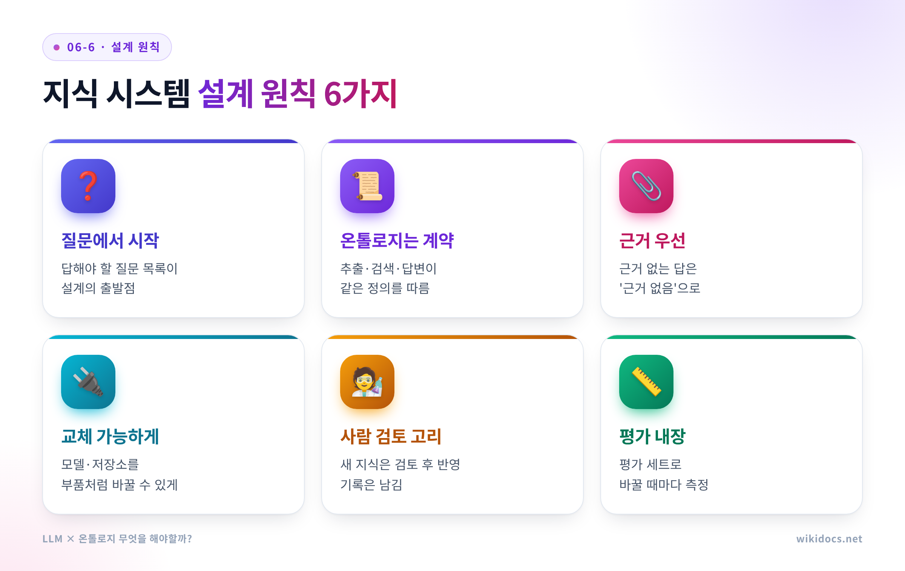

<!--
**상태**: 🔵 검토 중
**분류**: 06. RAG와 LLM 시스템 설계
**태그**: #설계
**작성일**: 2026-11-22
-->
> 📅 **최종 확인**: 2026-11-22

지금까지 다룬 내용을 **설계 원칙 6가지**와 **설계 체크리스트**로 정리합니다. 새 시스템을 기획할 때, 그리고 이미 만든 시스템을 점검할 때 이 페이지를 기준표로 쓰세요.

## 요약

- 원칙: **질문에서 시작, 온톨로지는 계약, 근거 우선, 교체 가능, 사람 검토 고리, 평가 내장**
- 각 원칙은 이 책의 특정 장과 연결되어 있습니다. 막히면 해당 장으로 돌아가세요.
- 마지막의 **설계서 템플릿**을 채우면 프로젝트 첫 회의 자료가 됩니다.

## 설계 원칙 6가지



| 원칙 | 뜻 | 지키지 않으면 | 예시 | 관련 장 |
|---|---|---|---|---|
| 1. 질문에서 시작 | 답해야 할 질문 목록이 설계의 출발점 | 아무도 묻지 않는 거대한 온톨로지 | 구매팀 질문 10개로 시작 | 03-4 |
| 2. 온톨로지는 계약 | 추출·검색·답변·검증이 같은 정의를 따름 | 단계마다 용어가 달라 오류 | 관계 목록을 프롬프트에 자동 삽입 | 05-1 |
| 3. 근거 우선 | 근거가 없으면 "근거 없음" | 그럴듯한 환각 답변 | 근거 번호 인용 + 검증 | 05-3 |
| 4. 교체 가능하게 | 모델·저장소를 부품처럼 바꿈 | 모델 교체 때마다 전면 재개발 | 역할 명세 + 평가 기준 | 06-5 |
| 5. 사람 검토 고리 | 새 지식은 검토 후 반영, 기록을 남김 | 잘못된 사실이 계속 퍼짐 | 새 개체·환각 의심만 검토 | 04-4 |
| 6. 평가 내장 | 바꿀 때마다 같은 평가 세트로 측정 | "좋아진 것 같다"는 감으로 운영 | 월 1회 30문항 평가 | 07장 |

## 이 책의 예제로 본 원칙

| 원칙 | 이 책의 예제에서 |
|---|---|
| 질문에서 시작 | 03-4에서 Q1~Q5 질문으로 `company.ttl`을 설계 |
| 온톨로지는 계약 | 05-1에서 온톨로지로부터 추출 프롬프트를 자동 생성 |
| 근거 우선 | 04-2에서 근거 문장이 원문에 없는 사실(F모터스)을 자동으로 걸러 냄 |
| 교체 가능하게 | 06-1의 라우터는 규칙이든 작은 모델이든 같은 입력·출력으로 교체 가능 |
| 사람 검토 고리 | 04-2에서 새 회사(E배터리)는 자동 반영하지 않고 검토로 보냄 |
| 평가 내장 | 07-1에서 정밀도·재현율로 추출 품질을 숫자로 측정 |

## 설계 체크리스트

**요구사항**
- [ ] 사용자와 대표 질문 10개 이상을 정했다
- [ ] 정확도·속도·보안 요구 수준을 정했다
- [ ] 질문을 설명형·관계형·복합형으로 나눴다 (06-1)

**지식**
- [ ] 질문에 필요한 최소 온톨로지를 만들었다 (03-4)
- [ ] 사실마다 출처·날짜·승인 기록을 남긴다 (04-4)
- [ ] SHACL 등으로 데이터 규칙을 자동 검사한다 (02-4)

**LLM과 검색**
- [ ] 역할별로 모델을 배치하고 명세를 남겼다 (06-5)
- [ ] 근거 인용과 "근거 없음" 규칙을 적용했다 (05-3)
- [ ] LLM이 필요 없는 구조화 데이터는 규칙으로 처리한다 (06-4)

**운영**
- [ ] 평가 세트로 정기 측정한다 (07-3)
- [ ] 권한별로 조회 가능한 정보를 제한한다
- [ ] 질문·근거·답변 로그를 보관한다
- [ ] AI 관련 법·가이드라인 적용 여부를 확인했다 (06-3)

## 설계서 템플릿

```text
# ○○ 지식 기반 AI 시스템 설계서 (v0.1)

## 1. 목적
- 해결할 문제:
- 성공 기준 (숫자로):

## 2. 사용자와 질문
- 사용자:
- 대표 질문 10개 (설명형/관계형/복합형 표시):

## 3. 요구 수준
- 정확도: / 속도: / 보안·권한:

## 4. 계층별 설계 (06-4)
| 계층 | 결정 | 이유 |
| 1. 데이터 원천 | | |
| 2. 수집·추출 | | |
| 3. 지식 | | |
| 4. 검색·추론 | | |
| 5. LLM 오케스트레이션 | | |
| 6. 응용 | | |
| 거버넌스 | | |

## 5. 역할별 모델 (06-5)
| 역할 | 필요한 능력 | 모델 후보 | 평가 기준 |

## 6. 결정 기록
- [결정 001] ...

## 7. 시범 계획
- 범위 / 기간 / 평가 방법
```

[[TIP("요령: 설계서도 AI와 함께")]]

이 템플릿과 06장 내용을 대화형 AI에 주고 "우리 상황(○○)에 맞춰 설계서 초안을 채워 줘. 모르는 부분은 [확인 필요]로 남겨 줘"라고 요청하면 첫 초안을 빠르게 만들 수 있습니다. 초안의 결정마다 **이유가 우리 상황에 맞는지** 팀이 함께 검토하세요.

[[/TIP]]

## 관련 페이지

- 06-4. 원하는 시스템을 만드는 설계 방법
- 06-5. 역할별 LLM 모델 활용법
- 📚 07장 평가와 품질
- 📚 08장 실전 프로젝트
