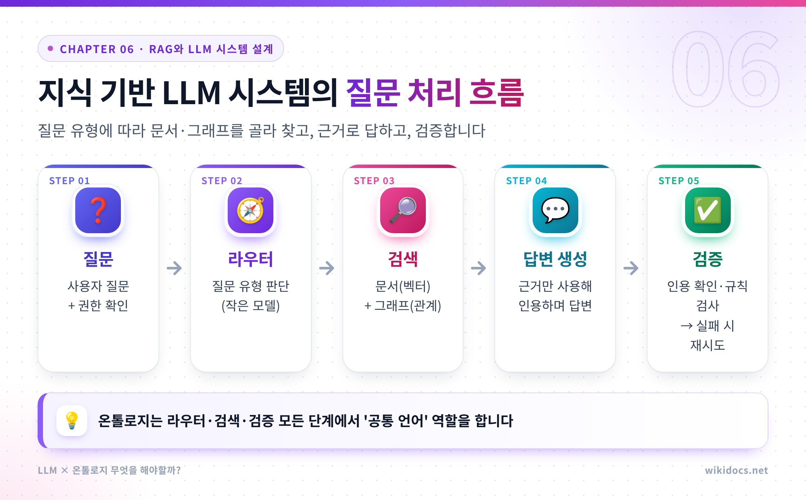
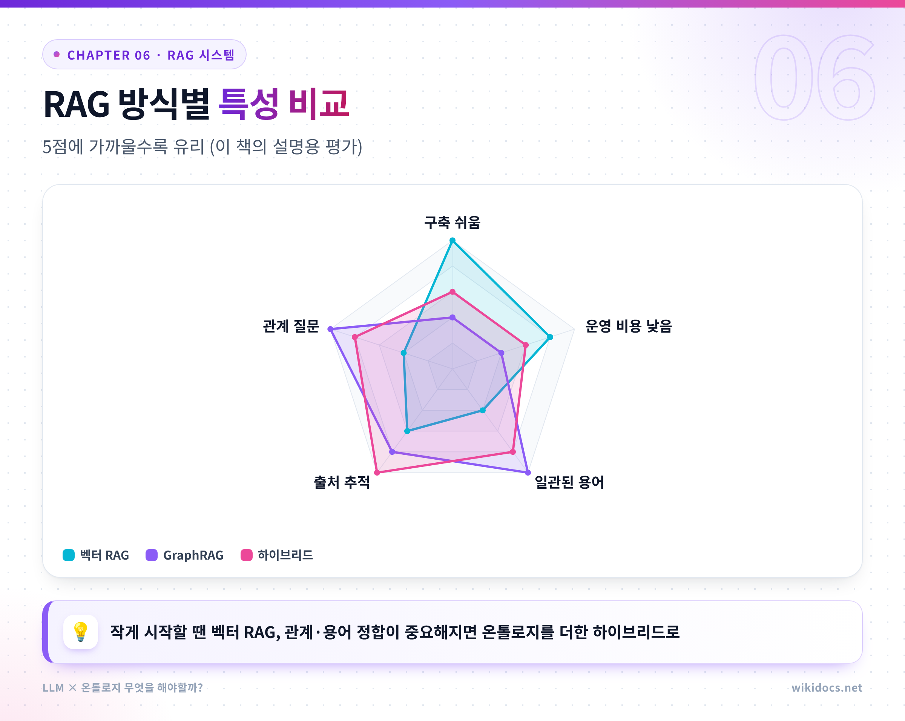

RAG의 종류와 온톨로지의 관계, 앞으로의 LLM 활용 방향, 그리고 원하는 지식 시스템을 설계하고 LLM을 역할별로 배치하는 방법을 다룹니다.

[[TIP("이 장을 읽고 나면")]]

- 벡터 RAG, GraphRAG, 하이브리드 RAG의 차이와 쓰임을 구분할 수 있습니다.
- 앞으로 LLM 활용이 어디로 가는지, 그때 온톨로지가 왜 핵심 자산인지 설명할 수 있습니다.
- 우리 조직에 맞는 지식 기반 LLM 시스템을 6계층으로 설계하고, 역할별로 모델을 배치할 수 있습니다.

[[/TIP]]

## 이 장의 구성

[[SubPages]]
