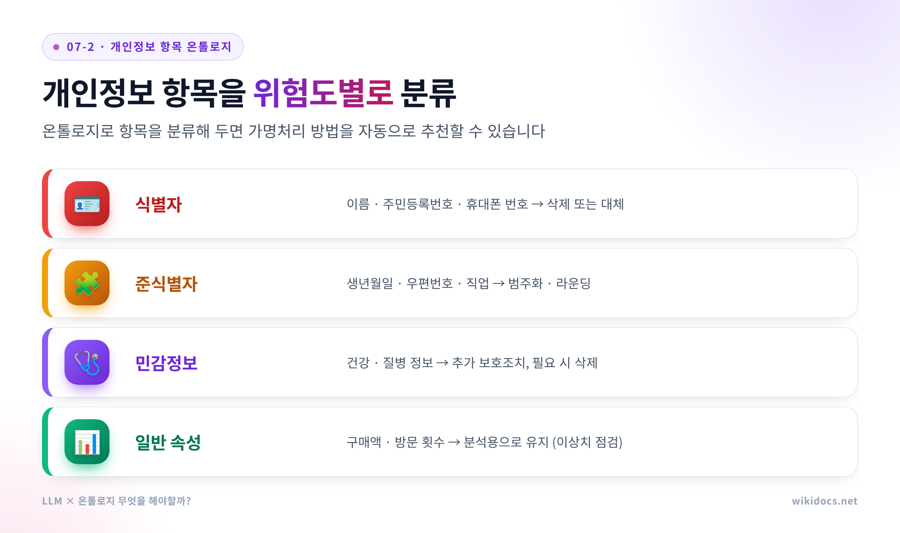

<!--
**상태**: 🔵 검토 중
**분류**: 07. 실전 프로젝트
**태그**: #프로젝트 #개인정보
**작성일**: 2026-11-22
-->
> 📅 **최종 확인**: 2026-11-22

두 번째 실전 프로젝트는 **개인정보 항목 온톨로지**입니다. 회사에 흩어진 수많은 데이터 컬럼을 "식별자", "준식별자", "민감정보" 같은 유형으로 분류해 두면, 가명처리 방법을 자동으로 추천하고 LLM에 데이터를 넣기 전 위험을 점검할 수 있습니다.

## 요약

- 데이터 항목을 **식별 위험도**에 따라 분류하는 온톨로지를 만듭니다.
- 각 유형에 **권장 가명처리 기법**을 연결해 두면, 새 데이터가 들어올 때 처리 방법을 자동 추천할 수 있습니다.
- 『가명정보 A to Z』의 내용을 기계가 읽을 수 있는 형태로 옮기는 프로젝트입니다.

## 항목 분류 체계



## 온톨로지 예시

```turtle
@prefix pi: <http://example.org/privacy#> .

# 항목 유형
pi:Identifier      a owl:Class ; rdfs:label "식별자"@ko .
pi:QuasiIdentifier a owl:Class ; rdfs:label "준식별자"@ko .
pi:SensitiveInfo   a owl:Class ; rdfs:label "민감정보"@ko .

# 권장 기법
pi:Deletion        rdfs:label "삭제"@ko .
pi:Generalization  rdfs:label "범주화"@ko .
pi:Tokenization    rdfs:label "토큰화"@ko .

pi:recommendedTechnique a owl:ObjectProperty .
pi:Identifier      pi:recommendedTechnique pi:Deletion , pi:Tokenization .
pi:QuasiIdentifier pi:recommendedTechnique pi:Generalization .

# 실제 데이터 컬럼 (가상의 고객 테이블)
pi:col_name     a pi:Identifier ;      rdfs:label "customer_name" .
pi:col_phone    a pi:Identifier ;      rdfs:label "phone_no" .
pi:col_birth    a pi:QuasiIdentifier ; rdfs:label "birth_date" .
pi:col_zip      a pi:QuasiIdentifier ; rdfs:label "zip_code" .
pi:col_diagnose a pi:SensitiveInfo ;   rdfs:label "diagnosis_code" .
```

이렇게 정의하면 "이 테이블의 각 컬럼에 어떤 기법을 적용해야 하나?"를 SPARQL 한 번으로 조회할 수 있습니다.

```sparql
SELECT ?column ?technique WHERE {
  ?col rdfs:label ?column ; a ?type .
  ?type pi:recommendedTechnique/rdfs:label ?technique .
}
```

**실행 결과** (rdflib로 실행)

```text
birth_date | 범주화
customer_name | 삭제
customer_name | 토큰화
phone_no | 삭제
phone_no | 토큰화
zip_code | 범주화
```

`diagnosis_code`(민감정보)는 결과에 없습니다. 민감정보 유형에 **권장 기법을 아직 연결하지 않았기 때문**입니다. 이처럼 질의 결과에 빠진 항목을 보면 온톨로지에서 정의가 비어 있는 부분을 찾을 수 있습니다.

## LLM과 함께 쓰기

| 작업 | LLM의 역할 | 온톨로지의 역할 |
|---|---|---|
| 새 테이블 분류 | 컬럼 이름·샘플 값으로 유형 후보 제안 | 허용 유형 목록과 정의 제공 |
| 가명처리 계획서 초안 | 문서 형태로 작성 | 컬럼별 권장 기법 근거 제공 |
| 비정형 텍스트 점검 | 문장 속 이름·연락처 탐지 | 탐지 대상 유형 정의 |

[[TIP("주의")]]

LLM에 컬럼 이름과 **샘플 값**을 보낼 때는 실제 개인정보가 들어가지 않도록 가짜 값이나 마스킹한 값을 사용하세요. 분류 결과는 담당자가 최종 확인하고, 실제 가명처리는 「가명정보 처리 가이드라인」의 절차(사전 준비 → 위험성 검토 → 가명처리 → 적정성 검토 → 안전한 관리)를 따릅니다.

[[/TIP]]

## 실무 체크포인트

- [ ] 항목 유형마다 정의와 예시를 적었는가
- [ ] 유형별 권장 기법을 가이드라인 근거와 함께 연결했는가
- [ ] LLM에 보내는 샘플 값에 실제 개인정보가 없는가
- [ ] 자동 분류 결과를 담당자가 검토하는가

## 근거·출처

| 구분 | 출처 | 비고 |
|---|---|---|
| 가이드라인 | [가명정보 처리 가이드라인 (2024.2. 개정, 개인정보보호위원회)](https://www.pipc.go.kr/np/cop/bbs/selectBoardArticle.do?bbsId=BS217&mCode=D010030000&nttId=9900) | 처리 절차·기법 |

## 관련 페이지

- 07-1. 금융 온톨로지 구축
- 07-3. 사내 지식 온톨로지
- 📚 02-3. SKOS로 용어 체계 만들기
- 📚 『가명정보 A to Z』 04장 가명처리 기법
