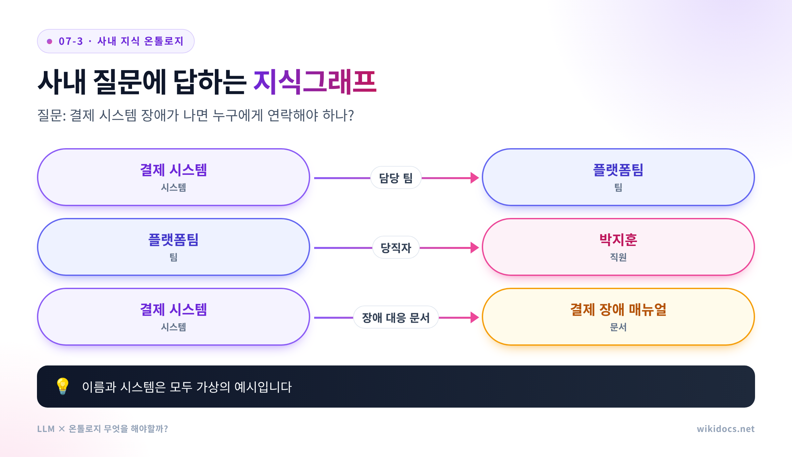

<!--
**상태**: 🔵 검토 중
**분류**: 07. 실전 프로젝트
**태그**: #프로젝트
**작성일**: 2026-11-22
-->
> 📅 **최종 확인**: 2026-11-22

세 번째 실전 프로젝트는 **사내 지식 온톨로지**입니다. "이 시스템 담당자는 누구지?", "이 문서의 최신 버전은?"처럼 회사 안에서 매일 반복되는 질문에, 조직·시스템·문서의 관계를 담은 지식그래프와 LLM이 함께 답하게 만듭니다.

## 요약

- 핵심 개념: **사람, 팀, 시스템, 문서, 프로젝트**
- 문서 검색(RAG)만으로는 어려운 "누가 담당인가", "무엇이 연결되어 있나"를 지식그래프가 답합니다.
- 작게 시작해 **자주 묻는 질문 상위 20개**부터 해결하는 것이 성공 비결입니다.

## 예시: 장애 대응 질문



**질문:** 결제 시스템 장애가 나면 누구에게 연락해야 하나?

```text
결제 시스템 ─담당 팀→ 플랫폼팀 ─당직자→ 박지훈
결제 시스템 ─장애 대응 문서→ 결제 장애 매뉴얼
```

GraphRAG(05-2)로 이 사실들을 근거로 주면 LLM은 이렇게 답할 수 있습니다. (설명용 예시)

```text
결제 시스템은 플랫폼팀 담당이며 [1], 현재 당직자는 박지훈님입니다 [2].
대응 절차는 「결제 장애 매뉴얼」을 확인하세요 [3].
```

## 핵심 관계

| 관계 | 주어 → 목적어 | 데이터 출처 예 |
|---|---|---|
| 소속된다 | 사람 → 팀 | 인사 시스템 |
| 담당한다 | 팀 → 시스템 | 시스템 관리 대장 |
| 당직자 | 팀 → 사람 | 당직 일정표 |
| 설명한다 | 문서 → 시스템 | 문서 저장소 (LLM으로 추출) |
| 참여한다 | 사람 → 프로젝트 | 프로젝트 관리 도구 |

[[TIP("요령: 자동으로 바뀌는 정보는 원본에서 가져오기")]]

당직자처럼 자주 바뀌는 정보를 지식그래프에 손으로 적으면 금방 틀린 정보가 됩니다. **원본 시스템(일정표, 인사 시스템)에서 정기적으로 가져오는 연결**을 만들고, 지식그래프에는 "언제 가져온 정보인지"를 함께 기록하세요.

[[/TIP]]

## 단계별 도입

| 단계 | 할 일 | 기간 예시 |
|---|---|---|
| 1 | 자주 묻는 질문 20개 수집 (메신저·헬프데스크) | 1~2주 |
| 2 | 질문에 필요한 개념·관계만 모델링 (03-4) | 1주 |
| 3 | 원본 시스템에서 데이터 가져오기 | 2~4주 |
| 4 | GraphRAG 질의응답 시범 운영 | 2~4주 |
| 5 | 평가(06-3) 후 질문 범위 확대 | 계속 |

## 주의할 점

- 조직 정보에는 개인정보가 포함됩니다. **필요한 범위의 정보만** 담고 접근 권한을 정합니다.
- 권한이 다른 정보(인사 평가 등)는 지식그래프에 넣지 않거나, 질의 단계에서 사용자 권한으로 걸러 냅니다.
- 이 페이지의 이름·시스템은 모두 가상의 예시입니다.

## 실무 체크포인트

- [ ] 실제로 자주 묻는 질문에서 시작했는가
- [ ] 자주 바뀌는 정보는 원본 시스템과 자동으로 연결했는가
- [ ] 개인정보와 접근 권한 기준을 정했는가

## 관련 페이지

- 07-1. 금융 온톨로지 구축
- 07-2. 개인정보 항목 온톨로지
- 📚 03-4. 지식그래프 모델링 실습
- 📚 05-4. 온톨로지 기반 AI 에이전트
